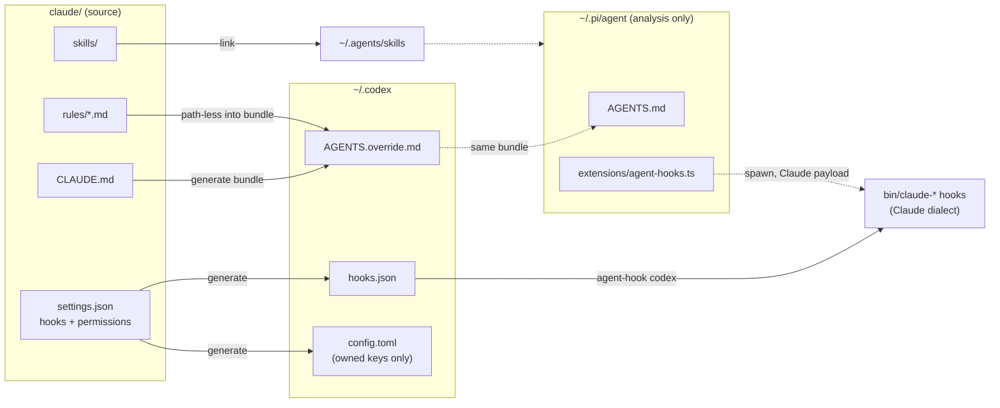

# Agent Harness Parity

Artifact: https://claude.ai/code/artifact/d4431357-c7c1-4e11-a65c-5e363f1b72e8

This plan covers what it takes for Codex and pi to run with the same instructions, rules,
skills, hooks, and guardrails that `claude/` gives Claude Code. It analyzes all three
harnesses, but implements Codex only. pi is analyzed so the Codex design doesn't close
doors on it; building pi's side waits on the risks in [pi](#pi). The goal for Codex is as
close to full parity as the harness allows, with each remaining gap named.

Versions measured: Claude Code 2.1.310, Codex CLI 0.163.0, pi 1.4.0. Wherever a claim was
checked against the installed binary rather than the docs, the plan says so.

## The question

Can one source tree, `claude/`, drive three harnesses with different configuration
models, without becoming three hand-maintained copies that drift apart? If so, what does
each piece of Claude config turn into on the other two, and what can't be carried over?

## What each harness offers

| Capability | Claude Code | Codex | pi |
|---|---|---|---|
| Global instructions | `~/.claude/CLAUDE.md` | `~/.codex/AGENTS.md`, or `AGENTS.override.md` instead of it | `~/.pi/agent/` holds one file, the first found of `AGENTS.override.md`, `AGENTS.md`, `CLAUDE.md` |
| Repo instructions | `CLAUDE.md`; `AGENTS.md` when no `CLAUDE.md` exists (or both, by setting) | `AGENTS.md`; `CLAUDE.md` through `project_doc_fallback_filenames` | One per directory, `AGENTS.md` before `CLAUDE.md` |
| Rules, path-less | `~/.claude/rules/*.md`, always loaded | None | None |
| Rules, path-scoped | Loaded on first touch of a matching file | None | None (an extension could add it) |
| Skills | `~/.claude/skills` | `~/.agents/skills`, `~/.codex/skills` | `~/.agents/skills`, `~/.pi/agent/skills` |
| Hooks | Subprocess, JSON on stdin, exit 2 blocks | Subprocess, same payload and exit-2 convention, plus trust-by-hash | No hooks. In-process TypeScript extensions |
| Permissions | `allow`/`deny` patterns, auto mode | Sandbox, approval policy, `.rules` exec policy, `PermissionRequest` hook | None. Every tool call runs |
| Command wrapper | `CLAUDE_CODE_SHELL_PREFIX` (whole command as one argument) | Not found | `shellCommandPrefix`, a preamble line, not a wrapper |
| Output style | `output-styles/`, `--settings` | `developer_instructions`, `model_instructions_file` | `SYSTEM.md`, `APPEND_SYSTEM.md`, `--append-system-prompt` |
| Status line | Command | Built-in only | Extension |

Verified against the binaries:

- `codex debug prompt-input` renders the exact model-visible prompt without a model call.
  It shows Codex 0.163 reading `~/.agents/skills` (probed with a throwaway `HOME`),
  reading a repo's `CLAUDE.md` once `project_doc_fallback_filenames = ["CLAUDE.md"]` is
  set, and `~/.codex/AGENTS.override.md` hiding exe.dev's `~/.codex/AGENTS.md` entirely.
- pi's `loadContextFileFromDir` returns the first match from that list, so a directory
  contributes one file. `~/.pi/agent/` has none today, so pi currently runs with no global
  instructions at all.
- pi applies `shellCommandPrefix` as `` `${commandPrefix}\n${command}` ``, so it can't
  wrap a command the way `claude-shell` does.

The Claude Code docs say it reads `AGENTS.md` only at project level. It does not read a
user-level `AGENTS.md`, `AGENTS.override.md`, or anything under `.agents/`.

## Design

### One source, three kinds of projection

This section assumes `claude/` stays the source of truth, which is open
([D1](#open-decisions), [D5](#open-decisions)). Each other harness gets a projection of
it, and every piece of config falls into one of three kinds:

- **Link**, where the format is the same: skills.
- **Generate**, where the knowledge is the same but the notation differs: the instruction
  bundle, `hooks.json`, the parts of `config.toml` we own. Generated files converge, so a
  run that changes nothing writes nothing.
- **Adapt**, where the behavior is the same but the runtime protocol differs: a shim
  that runs a Claude-dialect hook and translates its output.



### Hooks stay in one dialect

Every hook in `bin/` speaks Claude's protocol, and that stays the only protocol they
speak. Codex's protocol is nearly the same: the same stdin fields (`session_id`, `cwd`,
`hook_event_name`, `tool_name`, `tool_input.command`), `Bash` as the shell tool's name,
exit 2 with stderr to block, and concurrent launch of matching hooks. Where the two
differ, a single shim absorbs the difference: `agent-hook codex <script>` runs the script
and rewrites its output. Teaching each script a second dialect would spread one
translation across a dozen files.

The divergences the shim has to cover:

| Event | Claude emits | Codex wants |
|---|---|---|
| `PostToolUse` | `hookSpecificOutput.updatedToolOutput` (redaction) | `decision: "block"` with the replacement as `reason` |
| `PreToolUse` allow | `permissionDecision: "allow"` | Not accepted without `updatedInput`, so allow hooks move to `PermissionRequest` with `decision.behavior: "allow"` |
| `Stop` | Empty stdout to allow | "JSON required on exit 0" per the docs (unverified) |
| `Stop` payload | `prompt_id`, `background_tasks`, `session_crons` | `turn_id`, and neither list |

A wrapper also keeps the Codex hook *definitions* stable. Codex trusts each hook by a
hash of its definition, and re-asks through `/hooks` when the hash changes. Definitions
of the form `agent-hook codex claude-uv-check` change only when the set of hooks changes,
not when a script's body does.

### Which harnesses each piece reaches

Not everything in `claude/` applies off Claude. A hook declares the harnesses it supports
with a marker comment line, following the `# CLAUDE_HOOK_SELFTEST` convention:

```bash
# AGENT_HARNESSES: claude codex
```

The generator reads `settings.json` for *when* a hook fires and the marker for *where*,
so there's no separate list to drift. A skill carries the same fact in Agent Skills
`metadata` (`harnesses: claude`), and the linker skips it for `~/.agents/skills`. Missing
the marker means Claude only, so a new hook never reaches Codex by accident.

## Codex parity map

The implementation target. Parity is **full** where Codex behaves the same, **partial**
where the behavior is close with a named difference, and **gap** where Codex has no
mechanism.

### Instructions and rules

| Claude | Codex | Parity |
|---|---|---|
| `~/.claude/CLAUDE.md` | Bundle at `~/.codex/AGENTS.override.md`: `CLAUDE.md`, then path-less rules, then exe.dev's `AGENTS.md` when present (the override hides it otherwise) | Full |
| Path-less rules | In the bundle | Full |
| Path-scoped rules | A hook loads a rule the first time a matching path appears in a `Bash` or `apply_patch` call, through `additionalContext`, once per `session_id` (lazy, one of the options in [D2](#open-decisions)) | Partial: path extraction from shell is best-effort |
| Repo `CLAUDE.md` | `project_doc_fallback_filenames = ["CLAUDE.md"]`, `project_doc_max_bytes` raised (this repo's is close to the 32 KiB default) | Full |
| Subdirectory `CLAUDE.md`, lazy | Codex reads every file from the repo root down to the working directory, eagerly | Partial |

The bundle is Claude-flavored in places: it names `claude/rules/`, Artifacts, and the
plan-artifact Stop check. That's acceptable at first. If a line turns out to mislead
Codex, the fix is a harness marker on the text, not a second copy of the file.

### Skills

| Claude | Codex | Parity |
|---|---|---|
| `~/.claude/skills/*` | Linked into `~/.agents/skills/`, or `~/.codex/skills/` ([D3](#open-decisions)) | Full for the format |
| Skills that drive Claude-only tools (Agent, AskUserQuestion, Artifact, transcripts) | Marked `harnesses: claude` and not linked: `hook-creator`, `review-claude-config`, `harvest-sessions`, `skill-creator` (the last also collides with Codex's bundled skill of the same name) | Gap, by choice |
| `/skill-name` | `$skill-name` | Full |

### Hooks

| Claude registration | Codex | Parity |
|---|---|---|
| `SessionStart` `startup\|clear\|compact`: just-list, pre-commit-reminder, python-version, gh-status | `SessionStart` matcher on `source`, same values; plain stdout becomes context | Full |
| `SessionStart` (all): git-status | Same | Full |
| `PreToolUse Bash`: uv, tmpdir, git-dash-c, http-server-bind, rm-scope | Same, through the shim | Full (unverified end-to-end) |
| `PreToolUse Bash`: gh-api-check, awk-check (auto-approve) | Block half on `PreToolUse`, allow half on `PermissionRequest` | Full, if `PermissionRequest` fires where Claude would prompt |
| `PreToolUse Bash`: shell-comment-check | Not registered: it works around Claude's permission matcher, which Codex doesn't have | Not applicable |
| `PreToolUse Bash`: sleep-poll-check | Codex backgrounds commands differently, so the advice in the message is wrong there. Needs a Codex-specific message or nothing | Gap |
| `Stop`: `claude-stop` (precommit, finish nudge, plan-artifact) | `Stop` with `decision: "block"` and `reason`, which Codex turns into a continuation prompt | Partial: no `background_tasks`, so "paused" can't be told from "finished" |
| `UserPromptSubmit`, `PostToolUse`, `SessionEnd`: tab-status | Same events. `SessionEnd` has a 1s default timeout (3s max) | Full |
| `PreToolUse AskUserQuestion\|ExitPlanMode`, `Notification`: tab-status waiting | `PermissionRequest` covers approvals; Codex's question tool name is still to find | Partial |
| `Notification`: claude-sound | `notify` program in `config.toml` | Partial |
| `PostToolUse`: redact-secrets | Through the shim (block with the redacted text) | Partial: the result is replaced rather than edited, so it's marked as a hook block |

### Permissions

| Claude | Codex | Parity |
|---|---|---|
| `deny` `Bash(...)` patterns | One `agent-permission-check` hook reading `permissions.deny` from `settings.json` on `PreToolUse`, so the list is declared once | Full, if its matching follows Claude's on compound commands |
| `deny` `Edit(**/.env*)`, `Edit(**/uv.lock)` | Same hook on `apply_patch`, with paths taken from the patch headers | Full |
| `deny` `Read(**/.env*)` | `Bash(*.env*)` already covers shell reads, and Codex reads only through the shell | Full |
| `allow` (169 patterns) | Same hook on `PermissionRequest`, approving what `allow` matches | Full, if `PermissionRequest` covers every prompt |
| `defaultMode: auto` | `approvals_reviewer` / auto-review exists. Behavior differs and needs a trial | Partial |
| No sandbox | `sandbox_mode = "workspace-write"` today ([D4](#open-decisions)) | Different by design |

This replaces the hand-written `.rules` file on `origin/codex`, which restated part of
the deny list in a second notation.

### Everything else

| Claude | Codex | Parity |
|---|---|---|
| `CLAUDE_CODE_SHELL_PREFIX` → `claude-shell` memory cap | No per-command wrapper found. Running Codex itself inside the slice would cap the agent too, which is the thing the slice exists to avoid | Gap, to probe |
| `statusLine` command | Built-in only | Gap |
| Output styles, `harry` alias | `codex -c developer_instructions=...` per run | Full |
| `env` | `shell_environment_policy.set` for the variables that apply | Full |
| `effortLevel`, `model` | `model_reasoning_effort`, `model` (Codex's own models) | Not shared |
| `autoMemoryEnabled: false` | `memories` feature is already off | Full |
| `rust-analyzer-lsp` plugin | None | Gap |

## pi

pi could get two things for free: it reads `~/.agents/skills`, so linking skills there
([D3](#open-decisions)) reaches it, and the same instruction bundle linked to `~/.pi/agent/AGENTS.md` would give
it global instructions. Everything past those two goes through extensions, and the
extension system is where the risk is.

### Why extensions are the hard part

Claude and Codex run a hook as a subprocess behind a small, stable protocol: JSON in,
exit code and JSON out. pi has no such boundary. An extension is TypeScript loaded into
the pi process that subscribes to lifecycle events (`tool_call`, `tool_result`,
`before_agent_start`, `agent_before_settle`, `session_start`) and returns typed results.
That difference has consequences:

1. A second implementation of the hook protocol. For pi to run `bin/` hooks, an
   extension has to reproduce Claude's semantics: matchers, groups launched together,
   exit 2 versus JSON decisions, timeouts, the `SessionStart` context. That's code
   maintained alongside Claude's own implementation and able to drift from it, in a
   language nothing else here uses.
2. The contract is a moving TypeScript API. The reference is `extensions/types.ts` on
   pi's `main` branch, and pi is at 1.x, moving fast. exe.dev installs pi into
   `~/.local/pi`, outside mise, so there's no lockfile or cooldown in front of its
   upgrades, and an upgrade can break the extension without warning.
3. Failures close everything. A `tool_call` handler that throws blocks the tool. That
   suits a deny check, but one bug in the adapter blocks every `bash` call, the same blast
   radius as a broken `claude-shell`.
4. Nothing to fall through to. pi never prompts. The allow hooks' contract ("emit
   nothing and the normal prompt decides") has no prompt here, so falling through means
   running. Allow patterns mean nothing, and the deny list becomes the whole policy.
5. Parallel tool calls. One assistant message can start several tool calls at once,
   so a hook can't assume it sees calls in order.
6. It sits beside exe.dev's own extension. `~/.pi/agent/extensions/exe-dev` already
   hooks the provider path. Load order decides which handler sees an event first.

Unlike Codex, extensions can reach behavior hooks can't: `tool_result` can redact a
result in place, path-scoped rules can be appended to a `read` result, and
`agent_before_settle` can request a continuation, so `claude-stop`'s block-and-retry maps
cleanly. pi's ceiling on parity is higher than Codex's. Getting there costs more.

### The shape it would take

If pi is built later, it should keep the TypeScript as thin as possible, with every
decision still living in `bin/`:

- One extension, `agent-hooks.ts`, reading a generated hook table (the same generator
  as Codex, with a pi target) and spawning each script with a Claude-shaped payload.
  `bash` becomes `Bash`, and `edit`/`write` become `Edit`/`Write`.
- Its own handling: exit 2 or `deny` becomes a block, `SessionStart` stdout becomes a
  message, `Stop` blocks become an `agent_before_settle` continuation, and
  `updatedToolOutput` becomes a `tool_result` replacement.
- `claude-shell` reached by overriding the `bash` tool with a `spawnHook` (pi ships an
  example, `bash-spawn-hook.ts`), since `shellCommandPrefix` can't wrap.
- A self-test driven through pi's RPC or SDK mode, typechecked against the installed
  version, so an upgrade that breaks the API fails a check instead of a session.

## Prior art

Several tools already generate per-harness config from one source. The question for
each: does it handle the hard parts (hooks, permissions, path-scoped rules, user-level
config), or only instructions and skills?

| Tool | Harnesses relevant here | What it syncs | Model | Activity |
|---|---|---|---|---|
| [rulesync](https://github.com/dyoshikawa/rulesync) | Claude Code, Codex, pi, and many more | Rules, ignore, MCP, commands, subagents, skills, hooks, permissions; project and global | Generate from `.rulesync/` | ~1.5k stars, v41.0.0 on 2026-10-24 |
| [ruler](https://github.com/intellectronica/ruler) | Claude Code, Codex, pi, and about 30 more | Instructions (concatenated, with source markers), MCP, skills and subagents (experimental); global mode | Generate from `.ruler/` | ~3k stars, describes itself as a beta |
| [amtiYo/agents](https://github.com/amtiYo/agents) | Claude Code, Codex, others | Instructions, skills, MCP | Generate from `.agents/`, `CLAUDE.md` as an `@AGENTS.md` wrapper | ~100 stars |
| [ai-config-sync-manager](https://github.com/slash9494/ai-config-sync-manager) | Claude Code, Codex | Instructions, skills, agents, MCP, hooks, permissions (per its description) | Bidirectional sync | ~45 stars |
| [ktjn/agent-sync](https://github.com/ktjn/agent-sync) | Claude Code, Codex, pi, others | Global instructions and skills | Symlinks from one master, a PEP 723 `uv` script | No stars or releases |

Only rulesync claims the hard parts for all three harnesses. ruler, amtiYo/agents, and
ktjn/agent-sync stop at instructions and skills, which are the easy third of this plan.
ai-config-sync-manager syncs both ways, which gives each harness's files equal standing as
a source, and conflicts follow from that. This plan avoids that by having one source.

### rulesync, read from its source

I read the v41.0.0 source for the Codex and pi targets (`src/features/hooks/`,
`src/features/permissions/`, `src/features/rules/`). What it does with each hard part:

- Hook registrations, Codex. Event names are mapped from rulesync's own camelCase names,
  and handlers Codex would refuse to load are dropped with a warning (a bad `timeout`
  type stops the whole file from loading). It writes the registrations only. A hook's
  output is passed through unchanged, so the `PostToolUse` and allow differences in
  [Hooks stay in one dialect](#hooks-stay-in-one-dialect) are left to the hook.
- Hook registrations, pi. It generates a TypeScript extension that subscribes to pi's
  events and runs each command with `promisify(exec)(command)`. The command gets _no_
  stdin payload, any non-zero exit on `tool_call` blocks, and JSON output is ignored. The
  matcher is a regex against pi's lowercase tool names (`bash`). Every hook in `bin/`
  reads `tool_input.command` from stdin, so none of them would see the command they
  check.
- Stop on pi. `agent_before_settle` continues on exit 2, at most once per run, with the
  guard reset on `agent_settled`. Any other failure lets the agent stop. This is the
  part worth copying if pi is built.
- Permissions, Codex. Filesystem categories become a Codex permission profile in
  `config.toml`, and bash rules go to `.codex/rules/rulesync.rules`. Its comments say
  Codex now prefers permission profiles (`base_permission_profile`) over `sandbox_mode`,
  which `~/.codex/config.toml` still sets. Not verified here, but the binary does carry
  `permission_profile` keys.
- Permissions, pi. Only `defaultTools`, the set of built-in tools enabled at startup. Its
  comment: "Pi exposes no allow/ask/deny rule surface, so no canonical permission
  category maps onto it."
- Path-scoped rules, Codex. A rule scoped by globs is folded into the root `AGENTS.md`,
  always loaded, unless it opts into being written as a nested `<dir>/AGENTS.md`. That's
  eager loading with no filtering by repo, a cruder version of D2's eager option.

Adopting it would mean moving the source of truth into `.rulesync/`, in rulesync's own
format, and generating `~/.claude` from it as well, so Claude becomes one more
projection. It would also add an npm dependency with 41 major versions in 16 months and
three releases in the three days before 2026-10-24, under a 30-day cooldown for each
major. What it would buy, beyond the instructions and skills this plan gets cheaply, is
its pi extension and its Codex permission-profile translation. Neither passes our hooks
the payload they read. That's [D5](#open-decisions).

## Implementation phases (Codex)

Each phase leaves Codex working and is checked on its own before the next starts.
`codex debug prompt-input` is the probe for anything that lands in the prompt. Hooks
need a real session: `codex exec` with a hook that dumps its stdin.

1. Clean up the existing state. `~/.codex/hooks.json` calls `agent-session-start`,
   which exists only on `origin/codex`, so every Codex session today runs a broken
   `SessionStart` hook. `~/.codex/skills` holds links into the main clone, which would
   duplicate everything if skills move to `~/.agents/skills`. Replace both.
2. Instructions and skills. Add `bin/link-codex`, called from `install.sh` beside
   `link-claude` and guarded on `codex` being installed. It generates the bundle, links
   skills into the D3 location (honoring `harnesses`), and sets `project_doc_*` in
   `config.toml` through the TOML-aware helper from `origin/codex`
   (`link-codex-config`), which edits only the keys it owns. Check: `prompt-input` shows
   the rules, exe.dev's text, and a repo's `CLAUDE.md`.
3. The hook shim and context hooks. `agent-hook`, the `AGENT_HARNESSES` marker,
   `hooks.json` generated from `settings.json`, and a self-test for the shim. Start with
   `SessionStart` and the `PreToolUse` guards. Check, in one real session: the payload
   shape, the exit-2 block, whether hooks fire under `codex exec`, and the trust prompt.
4. Permissions. `agent-permission-check` on `PreToolUse` (deny) and
   `PermissionRequest` (allow), plus moving gh-api-check and awk-check onto the shim.
   Check: a denied command, an allowed command that would otherwise prompt, and a
   compound command.
5. Stop, tab status, notify, redaction. Probe the `Stop` empty-stdout rule first,
   since `claude-stop` relies on empty output meaning "allow".
6. Path-scoped rules. Built after the shim, because it's a hook.
7. Probe the remaining gaps. A Codex command wrapper for the memory cap, and the
   name of Codex's question tool.

## Open decisions

None of these are decided. The rest of the plan is written against the first option of
each where it has to pick one, so that it reads concretely, and changes where a decision
goes the other way.

- D1. Where the shared source lives.
  - Keep `claude/` and add projections. The hook protocol, the rule format, and the
    skills are Claude's to begin with, so nothing gets renamed. The cost is a directory
    named `claude` feeding three harnesses.
  - Move the shared parts to `agents/`. The name matches the job. The cost is touching
    `link-claude`, `CLAUDE.md`, rule-curator, skill-creator, and every doc that names
    the path, with no change to how the config works.
- D2. Path-scoped rules on Codex: lazy or eager.
  - Lazy: load a rule on the first matching path, as Claude does. This is the parity
    option. It needs per-session state and a best-effort path extractor for shell
    commands.
  - Eager: at `SessionStart`, load every rule whose `paths:` matches a file `git ls-files`
    lists. One script, no state, derived from the same frontmatter. It costs context: a
    Python repo carries `python`, `pyproject`, `pre-commit`, `github-actions`, and more
    from the first turn.
- D3. Skills in `~/.agents/skills` or `~/.codex/skills`.
  - `~/.agents/skills` is the Agent Skills standard location, and pi reads it too, so pi
    gets the skills without any pi work. The cost is that a Codex-only step changes pi's
    behavior. Skills do nothing until invoked, so that change is small.
  - `~/.codex/skills` keeps the change confined to Codex, and pi gets nothing until pi
    is planned.
- D4. Codex's sandbox.
  - Keep `workspace-write`. Claude runs here with no sandbox under auto mode, so this
    isn't parity, but it only adds a layer under the hooks and takes nothing away. If
    permission profiles have replaced `sandbox_mode` (see [rulesync](#rulesync-read-from-its-source)),
    keeping it means migrating the setting.
  - Drop it, for parity with Claude, and let the hooks be the only guard.
- D5. Build the projection here or adopt rulesync.
  - Build it here: a few scripts in `bin/`, with the hooks unchanged, the shim
    translating their output, and `claude/` as the source. The cost is maintaining the
    generator and the shim, and tracking Codex's hook changes ourselves.
  - Adopt rulesync: someone else tracks Codex and pi's formats, across many harnesses.
    The cost is moving the source into `.rulesync/`, taking a fast-moving npm dependency,
    and working around its pi extension, which doesn't pass the hooks their payload.

## Gaps that remain

- `claude-stop` can't tell "paused on background work" from "finished" on Codex. The
  payload has no `background_tasks` or `session_crons`.
- No command status line.
- No per-command wrapper found for the memory cap.
- No LSP plugin.
- Path-scoped rules on Codex depend on finding paths in shell text, which can miss.
