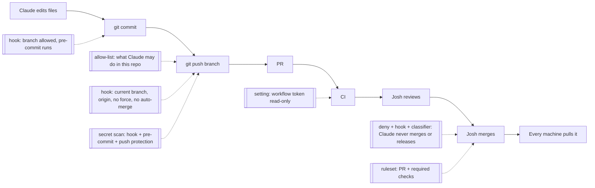

# Letting Claude commit and push

Artifact: https://claude.ai/code/artifact/4b4cec3a-a837-456b-9d3d-c3b77c2f1a0c

This plan covers what has to be true before Claude Code sessions may run
`git commit` and `git push` themselves, how Claude decides when to,
and the order to get there in.
It has to work on every machine these dotfiles reach, including a work laptop,
with whatever credential that machine uses: exe.dev's GitHub integration,
a `gh auth login`, or git over SSH with Josh's own key.
So nothing in it may depend on exe.dev.
Git may push with any of those; Claude pushing a branch other than the
default also needs `gh` able to read pull requests on that host (decision 2).

What Claude may do differs by repo, and changes over time as a spike grows up
or a repo starts deploying something.
So the plan builds a mechanism with a per-repo configuration,
and leaves which repos get which setting to that configuration rather than
settling it here.
It starts with Josh's own repositories under `JoshKarpel/`.
A work repository goes on a machine's own allow list (decision 7), which lives
outside dotfiles, so nothing about work repositories is recorded here.

Out of scope:

- Letting Claude merge, approve, or publish a release, anywhere. Those stay
  Josh's, even when asked for in the moment.
- Adversarial agents, such as a session steered by prompt injection. Defending
  against those takes isolation and sandboxing, which is a larger change to how
  sessions run. Nothing here blocks that work, and nothing here depends on it.
  This plan is for an agent acting in good faith that misreads a request or is
  overly determined to finish one.

## The question

What would have to be true to stop treating commit and push as the line
Claude never crosses, without losing the property that line protects: nothing
reaches a default branch that deploys, or the public, without Josh having looked
at it?

The answer this plan argues for: the line moves from _push_ to _merge_.
GitHub enforces that every change reaches a protected default branch through a
pull request whose required checks passed.
The harness enforces that Claude never merges or approves one,
with a deny rule, a hook, and the auto-mode classifier.
That second half is the weaker kind of guard, and the plan says so where it matters.

The aim is to shape the workflow so the mistakes a well-meaning agent makes
are caught, not to prove that no mistake is possible.
Each layer added (a credential that can do less, a hook that parses more)
moves closer to that, and none of them gets all the way there.

## Responsibility and identity

Josh takes responsibility for the work in his repos, whether he typed it or
asked Claude to.
Claude is a tool like an editor or a formatter, and using it isn't something to
hide or to announce on every commit with an attribution trailer.
Context about how the work was done, such as the PR description's fold naming
the model (decision 8), is a different thing, and is fine to land in a squashed
commit's message.
That is why getting this workflow right matters, and it settles three things
the rest of the plan depends on:

- Commits are authored as Josh, pushes and pull requests arrive as Josh, and
  no trailer marks them as Claude's.
- Giving Claude a separate GitHub identity (a bot account, or an app acting as
  itself) is the wrong fix, because it would make the record say someone other
  than Josh is responsible.
- Narrowing what Claude's credential _can do_, while it still acts as Josh,
  is the right kind of fix. Decision 3 covers how.

## Why now

Starting work from the phone already works: `manage-worktrees serve` opens a
worktree with Claude in it from a web form, and the zellij web client steers it.
Landing that work is the one step that still needs a desk, because today it
means a terminal running `git commit` and `git push` by hand.

Commit and push are separate decisions with different costs, so this plan treats
them separately:

| | Undo | Who sees it | Cost of a mistake |
|---|---|---|---|
| Commit on a worktree branch | `git reset`, local only | Nobody | Minutes of cleanup |
| Push a branch to a private repo | Delete the branch | Josh | Small |
| Push a branch to a public repo | Not possible for content; GitHub caches and indexes it | Everyone | A leaked secret must be rotated, private content is out |
| Land on a default branch | Revert, but it may already have deployed (see below) | Every machine | Bad code runs everywhere |
| Publish a release | Not possible; a PyPI version can only be yanked | Everyone, and every dev box by the next day | Bad code installed everywhere |

## What's true today

All of this was read from the live config, the Claude Code 2.1.325 binary, and
GitHub between 2026-11-10 and 2026-11-15, or measured with the probes in phase 0.

### In the harness

- `claude/settings.json` denies `Bash(git commit*)` and `Bash(git push*)`, and
  the global `CLAUDE.md` says the same in prose, with an exception for merge
  commits that need no judgment.
- Those deny rules are narrower than they look. A probe found that
  `git -c k=v commit`, `git -C . push`, and `bash -c 'git push …'` all get
  past them, while `env git push`, `VAR=x git push`, and `cd . && git push`
  are caught.
- `defaultMode` is `auto`. The auto-mode classifier's defaults (from
  `claude auto-mode defaults`) treat a push to _any_
  branch of the session's repo as ordinary, the default branch included. It
  blocks force pushes to shared branches, merging a PR no human approved,
  approving Claude's own PR, secrets or private content headed for a public
  repo, and commits that arm a CI pipeline to leak a secret. Those are model
  judgments, not string matches: useful, and not a guarantee. In headless probe
  runs it let through both a force push and a request to upload an SSH key,
  each in a sandbox where the prompt said the user wanted it.
- `claude-gh-api-check` approves `gh api` calls it can prove are reads and
  emits nothing for writes, which in auto mode leaves them to the classifier.
- `claude-redact-secrets` masks secret-shaped strings in tool output before the
  model sees them, which lowers the odds of a secret being copied into a file in
  the first place.
- The only secret-shaped pre-commit check in dotfiles is `detect-private-key`.

### Credentials

Every machine pushes as Josh. On an exe.dev dev box, git and `gh` go through
exe.dev's GitHub integration, whose `dev-box` integrations carry `--act-as-user`
([exe.dev docs](https://exe.dev/docs/integrations-github.md)). Elsewhere it's a
`gh auth login` token or Josh's SSH key. Either way, a push or a merge by Claude
_is_ a push or a merge by Josh as far as GitHub can tell, which is the
accurate record (see above).

What the credential may do differs by kind.
A `gh auth login` OAuth token with the `repo` scope administers the repo,
rulesets included.
The exe.dev integration is a GitHub App user access token: it acts as Josh, and
has only the permissions both Josh and the app have.
Probing it, every endpoint that needs `administration=read` (branch protection,
default workflow permissions) and `secrets=read` answered
`403 Resource not accessible by integration`, so it can't change rulesets, repo
settings, or secrets either.
It can push, and since GitHub requires the same `Contents: write` for merging a
pull request and for creating a release as for pushing
([permissions table](https://docs.github.com/en/rest/authentication/permissions-required-for-fine-grained-personal-access-tokens)),
it can do those too.

That decides what the server side can do. A ruleset can't treat Claude
differently from Josh, and requiring an approval doesn't help either: GitHub
doesn't let a PR's author approve it, and as the sole maintainer of these hobby
and solo projects, Josh has nobody else to give one.

### On GitHub

Default-branch rules for Josh's public repos with a clone on this box:

| Repo | Default-branch rules | Approvals required |
|---|---|---|
| dotfiles | no deletion, no force push | (no PR rule) |
| counterweight | + PR, status checks | 0 |
| claude-scriptorium | + PR, status checks, Copilot review | 0 |
| exe-dev-atlas | + PR, status checks | 0 |
| evp | + PR, status checks | 0 |
| waxy | + PR, status checks, linear history | 0 |
| without | + PR, status checks | 0 |
| ray (fork) | none | (no PR rule) |
| room (fork) | none | (no PR rule) |

The private repos split the same way: the ones that ship something have the PR
rule, and the spikes and demos don't.

The PR rule guarantees a PR exists and CI passed. With approvals at 0, it
doesn't guarantee anyone looked: anything holding Josh's credential can open a
PR and merge it once checks are green.
The repos with no PR rule other than dotfiles are unprotected on purpose: forks,
spikes, and demos, where a push to the default branch landing directly is the
point.

Whether GitHub secret scanning and push protection are on for these repos is
unknown, as are each repo's default `GITHUB_TOKEN` permissions and whether
Actions may create and approve pull requests: the exe.dev integration can't read
any of them.
Dotfiles' only workflow sets `permissions: {}` and grants its one job
`contents: read`.
Dotfiles has squash merging allowed and auto-merge off.

A published release is a deploy in seven repos: all six public repos above with a
PR rule, and one private one. Each runs a workflow `on: release: [published]`,
and the ones read for this plan upload to PyPI through trusted publishing.
exe-dev-atlas and claude-scriptorium are also what every dev box converges to
the next day, with the mise cooldown waived for them.
Their `pypi` environments have a branch policy and no required reviewer.

pre-commit.ci runs on dotfiles with `autofix_prs` at its default, so it pushes a
fix commit to any PR branch whose hooks changed files. A branch Claude pushed
can therefore gain a commit Claude's clone doesn't have.

### Why dotfiles master is special

Pushing to dotfiles `master` is a deploy, not a code change. `sync-branches`
fast-forwards every local branch on every machine hourly, and every bot-box runs
`git pull --ff-only && ./install.sh` daily. What lands there runs in every
shell, every Claude Code hook, and `claude-shell`, which every Bash call passes
through. A bad `claude-shell` breaks every session on every machine at once.
That is why dotfiles moves to PRs only (decision 4), while repos for spiking
keep taking direct pushes to their default branch.

## What could go wrong

Ranked by how hard each is to undo, which is also the order to spend effort in.
"Deny rule only" is weaker than it reads, since the probe above found spellings
that get past those rules.

| Failure | Undo | Where it can happen | What stops it today |
|---|---|---|---|
| Secret or private content pushed to a public repo, on _any_ branch | Impossible; rotate the secret | Every public repo | Deny rule only; classifier once lifted |
| Release published, which uploads to PyPI or reaches every dev box | Impossible; yank it and publish a fix | The seven publishing repos | Classifier only: `gh release create` isn't denied |
| Workflow change on a pushed branch exfiltrates repo secrets (a same-repo branch's `push` and `pull_request` runs get them) | Rotate the secrets | Any repo with Actions secrets | Deny rule only; classifier once lifted |
| Workflow on a pushed branch merges a PR or pushes a default branch with `GITHUB_TOKEN` | Revert, after it may have deployed | Any repo whose workflow token can write | Deny rule only; nothing in the harness sees what GitHub runs |
| Claude merges its own PR | Revert, after it may have deployed | Every repo | Classifier only: `gh pr merge` isn't denied |
| Claude pushes onto a PR with auto-merge armed, and it merges unreviewed | Revert, after it may have deployed | Every repo | Deny rule only |
| Change pushed straight to a default branch that deploys | Revert, after it may have deployed | dotfiles today | Deny rule only |
| Force push or deletion destroys history | Hard; reflog on someone's clone | Non-default branches (default branches block it) | Deny rule; classifier |
| Push to the wrong remote or repo | Delete it | Anywhere | `git remote set*` denied; classifier |
| Messy history, noisy commits | Squash on merge | Anywhere | Nothing needed beyond squash merges |

Two rows are worth noticing: `gh release create` and `gh pr merge` are
reachable today, deny rule or no deny rule on push, and only the classifier
stands in front of them.

## The invariant

The plan holds two statements, enforced in different places.

GitHub enforces the first:

> In every repo with a PR rule, every change reaches the default branch through
> a pull request whose required checks passed.

The harness enforces the second, as far as its hook parses. Claude:

> - pushes a default branch only where that repo's entry allows it
>   (decision 7), which is never a repo with a PR rule;
> - never pushes to a pull request with auto-merge armed;
> - never merges, approves, or enables auto-merge on a pull request;
> - never publishes a release;
> - never changes the rules that enforce the first statement, or the entries
>   that say what it may do.

The first statement holds only while the rulesets do. Where Josh's credential
administers his repos, anything holding it can delete a ruleset as easily
as it can merge, so the second statement has to cover that too.

The second statement holds only for what runs in the harness. A workflow runs
on GitHub with its own token, so decision 6 limits what that token can write.

Nothing in the harness sees inside a program Claude writes and then runs.
A Python script that calls the merge endpoint gets past a deny rule and a hook
alike; the classifier may catch it, and nothing guarantees it will.
The layer that does reach a script is the credential itself: what the token
can't do, no program holding it can either. That is why decision 3 narrows the
credential as a later phase.

Secrets are a separate problem, because neither statement touches them: a pushed
branch on a public repo is published whether or not it ever merges.
Decision 5 covers that.

## Where each guard lives



The layers differ in what they can promise:

- Settings rules (`deny`) are deterministic but match the command as written,
  and miss spellings the probe found (`git -C`, `git -c`, `bash -c`).
- A PreToolUse hook parses the command, so it can reason about branches, flags,
  remotes, and API endpoints, and can see through `git -C` and `git -c`.
  It can only prove what it parses.
- Neither of those sees what a script does once it runs: a Python script or a
  `just` recipe that pushes or merges is invisible to both.
- The auto-mode classifier judges content and intent, which nothing else here
  can, and is probabilistic.
- The credential's permissions bind everything that holds it, scripts included,
  but can't tell merging from pushing.
- GitHub rulesets hold no matter what ran in the harness, short of the
  harness editing them, but can only constrain Josh's identity as a whole,
  Claude included.

## When Claude commits and pushes

Allowing commit and push is half the change. The other half is telling Claude
when to use them, since today every source of guidance says not to.

### What Claude is told today

- Claude Code's own git sections are off: `includeGitInstructions: false` in
  `claude/settings.json`. When on, they say "Only create commits when requested
  by the user. If unclear, ask first.", "NEVER commit changes unless the user
  explicitly asks you to", and "DO NOT push to the remote repository unless the
  user explicitly asks you to do so", along with a safety protocol (never update
  git config, never skip hooks, prefer new commits over amending).
- The harness's system prompt keeps one general line that applies:
  "For actions that are hard to reverse or outward-facing, confirm first unless
  durably authorized or explicitly told to proceed without asking; approval in
  one context doesn't extend to the next."
  A push is outward-facing, so without a durable authorization in `CLAUDE.md`,
  this line alone asks Claude to confirm every push.
- Sessions started from claude.ai or Remote Control can carry a host-set
  proactivity level. At `default` it says "Do not create git commits, push to a
  remote, or create or update pull requests unless the user explicitly asks or
  confirms." At `proactive` it says "Commit, push, and create or update pull
  requests without asking whenever that is the natural next step of the task."
  `ask` is stricter than `default`.
- The global `CLAUDE.md` says "Don't create git commits or push changes on my
  behalf", with the clean-merge exception.

### What replaces it

The commit bullet in the global `CLAUDE.md` becomes a durable authorization,
worded as one so the harness's "unless durably authorized" clause applies:

- Commit on a worktree branch at each coherent step, once pre-commit passes,
  without waiting to be asked.
- Bring a branch up to date by merging the base branch in, never by rebasing.
- Don't amend a commit that has been pushed unless asked to.
- Push and open a pull request when the task's change is complete and its
  checks pass locally, or sooner when asked to show the work.
  In a repo whose entry allows default-branch pushes, push the default branch
  at the same point.
- In a fork, push the branch and don't open a pull request.
- Never merge, approve, enable auto-merge, or publish a release, even when
  asked to in the moment. Say that Josh has to, and stop.
- When unsure whether something belongs in the public record, ask (see below).

Whether this authorization holds under a host-set `default` proactivity level
is untested; phase 0 lists it.

## What stays out of the record

Secrets are the case a scanner can catch. The larger case is context Josh gives
Claude that he doesn't want in a commit, a PR, or a code comment:
timelines, other projects (private ones especially, including their names),
the order things will happen in, and decision criteria that rest on private
business information.
No scanner can see provenance, so this is guidance, in a new path-less rule
`claude/rules/public-record.md`. It loads unconditionally because it changes
what Claude writes.

It says, in short:

- Anything that lands in a repo or on GitHub (commit messages, PR and issue
  text, code comments, docs, plans) is public as far as Claude knows, even in a
  private repo, since visibility can change.
- What belongs there is what a stranger reading the repo needs: the change, the
  reason, the evidence. Context from the conversation that isn't about the
  change stays in the conversation.
- Name another project only if it's public and the change depends on it.
- When unsure, ask before committing, rather than writing it and hoping.

## Decisions

### 1. Commit: allow on any branch Claude may push

Claude commits freely on a worktree branch. It's local, `git reset` undoes it,
and reviewing a commit is no harder than reviewing a working tree.

- Allow when the current branch isn't the repo's default branch, or the repo's
  entry allows default-branch pushes (decision 7). A detached `HEAD` has no
  current branch to check, so a commit there is denied.
- The default branch here comes from `git symbolic-ref refs/remotes/origin/HEAD`,
  which is local and costs no network call.
  A repo with no `origin` has nowhere to push, so a commit is allowed on any
  branch, which covers a `git init` scratch repo.
  A repo with an `origin` and no `origin/HEAD` is refused rather than guessed
  at, with a message saying Josh needs to run `git remote set-head origin --auto`:
  Claude can't, since `Bash(git remote set*)` is denied.
- This branch check keeps the default branch tidy; it isn't the guard.
  Claude can move `origin/HEAD` locally, and a commit stays local either way,
  so nothing depends on the check holding: the push check (decision 2) reads
  the default branch from the remote itself.
- Don't otherwise gate commit on the allowed list. A commit stays local, so
  where `origin` points matters only at push.
- Refuse `--no-verify`/`-n`, so pre-commit always runs.
- Refuse every way of overriding config for the one command, on every git
  command the hook checks, push included: `-c`, `--config-env`, and any
  `GIT_CONFIG*` variable (which covers `GIT_CONFIG_COUNT` with
  `GIT_CONFIG_KEY_<n>`, `GIT_CONFIG_PARAMETERS`, and `GIT_CONFIG_GLOBAL`).
  Refuse pre-commit's `SKIP` and `PRE_COMMIT_ALLOW_NO_CONFIG` too.
- A variable counts wherever the compound command sets it, not only as a prefix
  on the git segment: `export`, `declare -x`, and `env` in an earlier segment
  set it just as well. A compound command that runs a git write alongside
  `source`, `.`, `eval`, or `set -a` is denied, since the hook can't see what
  those set. A variable exported from a shell startup file reaches the command
  without appearing in it at all; no parser sees that, and the push-time scan
  (decision 5) is what covers it.
- Refusing the skip flags proves nothing when no hook is installed, which is
  the state `gh repo clone` leaves a clone in. In a repo with a
  `.pre-commit-config.yaml`, the hook allows only when the hooks directory git
  will use (`git rev-parse --git-path hooks`, which follows `core.hooksPath`)
  holds pre-commit's `pre-commit` script. That also catches a separate
  `git config core.hooksPath …` or `pre-commit uninstall`, neither of which
  is denied.
- Allow `--amend` under the same conditions. Amending a pushed commit is left
  to guidance rather than a deny: Claude doesn't do it unless asked, and when
  asked, the force push it needs is still denied (decision 2), so Josh pushes
  that one.
- Allow a `git commit` that concludes a merge, conflicts resolved by Claude
  included, on any branch Claude may commit to. A messy merge on a branch is
  reviewed with the rest of the PR and squashed away on merge.
- Treat the other commands that create commits (`git merge`, `git pull`,
  `git cherry-pick`, `git revert`, `git am`) like `git commit` for the branch
  check, so a default branch Claude may not push can't gain local commits
  through them either. pre-commit's default `pre-commit` hook doesn't run for
  any of them, so the push-time secret scan (decision 5) is what covers their
  content.
- Leave out the forms that can't create a commit: `git merge --ff-only`,
  `git pull --ff-only`, and a bare `git pull` while `pull.ff` resolves to
  `only` (Josh's gitconfig sets it) only move a branch to commits that already
  exist, so they're allowed on any branch, the default included.

Cost: Claude writes the commit messages, and pre-commit runs inside Claude's
turn instead of Josh's. Squash merges mean the PR title and body are what
survives on the default branch, so the commit messages matter less than the PR.

### 2. Push: allow the current branch to `origin`, nothing else

- Allow `git push`, `git push -u origin HEAD`, and `git push origin <current>`
  when `origin` is on the allowed list (decision 7), and `<current>` either isn't
  the default branch or the repo's entry allows default-branch pushes.
- The options a push may carry are an allowlist: `-u`/`--set-upstream`,
  `-q`, and `-v`. Any other option denies, which covers force in every spelling
  (`-f`, `--force`, `--force-with-lease`, `--force-if-includes`),
  `--delete`/`-d`, `--mirror`, `--all`, `--tags`, `--follow-tags`,
  `--repo=<url>` (which replaces the remote), `--receive-pack`/`--exec`, and
  `--no-verify`. Refuse a `+` refspec, any refspec that renames (`src:dst`),
  and anything naming a branch other than the current one.
- Refuse config overrides on the push, as on the commit (decision 1).
  Every check below reads config from disk (`git config`,
  `git remote get-url --push`), so `git -c remote.origin.pushurl=… push` or
  `git -c push.default=matching push` would otherwise send the push somewhere,
  or send something, the hook never checked.
- Read the remote's state from the remote, not from local refs.
  Claude can rewrite `refs/remotes/origin/*` with `git update-ref` or
  `git symbolic-ref`, and those refs follow the fetch URL, which can differ from
  where the push goes. So the hook runs
  `git ls-remote --symref <push URL> HEAD 'refs/heads/*'` once per push, which
  needs only the credential git pushes with, and takes from it the default
  branch (what `HEAD` points at) and every branch's SHA.
  The **commits being pushed** are `git rev-list HEAD --not <those SHAs>`,
  dropping any SHA not present locally, which can only widen the range.
  That covers a branch's first push, and leaves out commits a merge of the
  default branch brought in, which are already on GitHub.
  The secret scan (decision 5) and the workflow-file ask (decision 6) both use
  this range. When `ls-remote` fails, deny.
- Deny when the branch's open pull request has auto-merge armed, as
  `gh pr view <branch> --repo <origin's repo> --json autoMergeRequest` reports.
  The `--repo` matters: in a fork's clone `gh` resolves against the parent by
  default, and would read someone else's PR that shares the branch name.
  Josh's alias
  (decision 4) arms auto-merge, and GitHub keeps it armed when someone with
  write access pushes, which Claude does as Josh, so a push onto that branch
  merges as soon as CI goes green. Draft or ready doesn't matter: with
  approvals at 0, auto-merge is what turns a push into a merge. No open PR
  (a branch's first push, a fork) is not a failure and allows; when the lookup
  itself fails (network, auth, a parse error), deny.
- The lookup needs `gh` authenticated for `origin`'s host, separately from
  whatever git pushes with. On a machine where git pushes over SSH and `gh`
  isn't logged in, Claude's branch pushes are denied with a message saying so,
  and Josh pushes there by hand. Treating an unreadable PR as unarmed would let
  a PR armed from another machine merge on Claude's push, and opening the PR
  (decision 8) needs the same `gh` anyway.
- A `default-branch` push skips the lookup. The push is itself the landing,
  so a PR auto-merging afterward adds nothing, and a spike still takes Claude's
  pushes from a machine with only an SSH key.
- Auto-merge armed between the hook's check and the push is a window the hook
  can't close. It's seconds wide, and opening it takes Josh acting on the PR at
  that moment, so the plan accepts it.
- Deny when the secret scanner (decision 5) flags the commits being pushed.
- Ask when the commits being pushed touch workflow files (decision 6).
- When a push is rejected as non-fast-forward, the way back is `git pull`,
  which merges. Anything can cause it: pre-commit.ci's autofix commits, Josh
  pressing "Update branch" on GitHub, a push from another machine.
- Check where the push actually goes, not what `origin`'s fetch URL says.
  For a bare `git push`, the branch's push remote (`branch.<b>.pushRemote`,
  then `remote.pushDefault`) must be `origin`, and the URL checked against the
  allowed list is `git remote get-url --push origin`, which applies
  `remote.origin.pushurl` and `url.*.pushInsteadOf`. `Bash(git remote set*)` is
  denied, but `git config remote.origin.pushurl …` is not.
- Check what the push sends, not only where. A bare `git push` sends whatever
  config says to: `remote.origin.push` refspecs, `push.default` (`matching`
  pushes every branch with a remote counterpart, the default branch included,
  and `upstream` pushes to `branch.<b>.merge`, which can be the default branch),
  and `push.followTags`. Any repo-local `git config` write can set these, so
  the hook allows a bare push only when `remote.origin.push` is unset,
  `remote.origin.mirror` is off (when true, a push to `origin` behaves as
  `--mirror`, deleting remote branches with no local counterpart),
  `push.default` resolves to `simple` or `current`, and `push.followTags` is off,
  and otherwise requires the explicit `origin <current>` form.

Josh doesn't rebase, and the `resolve-conflicts` skill already merges the base
branch in, so nothing in this workflow needs a force push. It stays denied with
no planned exception.

The push check reads the default branch from the remote, so unlike the commit
check (decision 1) it needs no `origin/HEAD`.

### 3. Merge, release, and every other `gh` write: guard them in the harness

Claude acts as Josh everywhere, and no token permission separates merging from
pushing, so blocking merge has to happen before the command leaves the
harness. Layered, so a gap in one isn't a gap in all:

- Deny `Bash(gh pr merge*)` and `Bash(gh release create*)` in `settings.json`
  as prefix backstops. The first also covers `--auto`: with 0 approvals
  required, auto-merge is a merge that fires as soon as CI goes green.
- The hook treats `gh` the way it treats `git`: it denies every `gh` write
  except a short allowlist, rather than listing the writes that are bad.
  A list of bad writes is incomplete before it ships. Beyond merging and
  approving, `gh repo sync` and `POST …/merge-upstream` write a fork's default
  branch, `PUT …/contents/<path>` and `…/git/refs` write any branch,
  `gh workflow run` starts a workflow, `gh repo deploy-key add` and
  `gh ssh-key add` mint credentials, `gh release create` publishes, and a
  GraphQL query read from a file (`-F query=@q.graphql`) is invisible to a parser.
- The allowed writes are `gh pr create` in the form decision 8 requires,
  `gh pr ready`, `gh pr comment`, `gh pr edit` limited to `--title`, `--body`,
  and `--body-file`, `gh issue create`, and `gh issue comment`.
  Each of them names its target with `--repo`, and the target must be on the
  allowed list, for the same reason as `gh pr create`: in a fork's clone `gh`
  can resolve to the parent, which would put a comment or an issue on someone
  else's repo under Josh's name.
- A comment can set off more writes than its own: a workflow triggered by
  `issue_comment`, or an app that acts on comment commands, runs with a token
  of its own. Dependabot's merge commands
  [were removed in January 2026](https://github.blog/changelog/2026-01-27-changes-to-github-dependabot-pull-request-comment-commands/),
  and the repo setup checklist covers the rest, since what a comment triggers
  is configured on GitHub, not in the harness.
- Reads keep the one list they have. `claude-gh-api-check` proves `gh api`
  reads, and for every other subcommand the hook reads the `Bash(gh …)` entries
  in the `allow` lists of the settings files in force (user, project, and local)
  and stays silent on a call one of them matches, leaving it to `allow`.
  The hook keeps no copy of that list to drift from it.
  The writes it denies by name are checked first, so no `allow` entry can let
  one through, and its self-test asserts that no `allow` entry matches a write
  the hook knows of, which catches an entry as broad as `Bash(gh pr *)`.
  A `gh` call that matches neither an `allow` entry nor an allowed write is
  denied, any GraphQL mutation included.
- Default deny covers the rules and the repo itself: rulesets, branch
  protection, `gh repo edit`, and `PATCH` or `DELETE` on `repos/<o>/<r>`, which
  changes the default branch or makes a private repo public. Where the
  credential administers the repo, a confused agent "fixing" a blocked merge
  could otherwise remove the ruleset that blocked it.
- Deny the easy routes to the token, so it isn't handed to a script that calls
  the API where no hook can see it: `gh auth token`, `gh auth status` with
  `-t`/`--show-token`, `git credential fill`, and `gh auth git-credential`.
  With `gh` configured as git's credential helper, the last two print the
  token as readily as the first. On an exe.dev box there's no token to print.
  This closes only the easy route: a stored token stays readable from disk.
- The classifier's "Merge Without Review" rule stays the third layer, and the
  global `CLAUDE.md` says plainly that merging, approving, and releasing are
  Josh's, whatever was asked in the session.

#### Later: a narrower credential that still acts as Josh

The harness layers can't see inside a script; the credential can.
A token that lacks a permission denies it to every program that holds it.
The shape that fits the identity section is a
[GitHub App user access token](https://docs.github.com/en/apps/creating-github-apps/authenticating-with-a-github-app/authenticating-with-a-github-app-on-behalf-of-a-user):
it acts as Josh (his avatar with the app's badge in the UI, Josh as the actor
in the audit log), and has only the permissions both Josh and the app have.

- What it can buy: an app without `Administration` can't delete a ruleset,
  change a repo's visibility, or move its default branch, which takes the last
  bullet of the invariant off the hook's shoulders. Without `Workflows`, it
  should be unable to push workflow-file changes at all, which would make
  decision 6's ask structural; phase 0 lists that as unverified.
- What it can't buy: merging and releasing need the same `Contents: write` as
  pushing, so those stay guarded in the harness however the token is scoped.
- How it's minted: fine-grained personal access tokens can only be created in
  the web UI, so "mint a scoped token at session start" isn't available for
  them. App user tokens expire after 8 hours and come with a 6-month refresh
  token
  ([docs](https://docs.github.com/en/apps/creating-github-apps/authenticating-with-a-github-app/generating-a-user-access-token-for-a-github-app)),
  so a background job (not the session) refreshes one and writes it where
  Claude's `gh` reads it, for example a separate `GH_CONFIG_DIR` set in
  `claude/settings.json`'s `env`.
  The permissions are fixed by the app's configuration; a request can narrow
  the token to one repository but not to fewer permissions.
- Where it already exists: the exe.dev integration is this shape today (see
  Credentials), so exe.dev boxes already lack `Administration`. The work is
  for machines that use `gh auth login`.
- What it needs to mean anything: Josh's broader credential must be out of
  Claude's reach. On the same Unix user it isn't, since Claude can read
  `~/.config/gh` and `~/.ssh`. Claude Code's sandbox can deny those reads, which
  is part of the larger isolation work this plan leaves out of scope, and is
  what turns the narrower token from a default into a boundary.

This is phase 5, after everything else works, because the hook covers the
same ground for the common case and the token only adds coverage for scripts.

#### Alternatives rejected

B. Give Claude a separate identity through exe.dev, by dropping `--act-as-user`
on dev-box integrations so every write arrives as
`exe-dev-github-integration[bot]`, and then requiring one approval.
`bin/exe-dev` already builds bot-box integrations this way. Rejected because
the record would no longer say Josh is responsible for his own work, and
because it only exists on exe.dev: a work laptop pushing over SSH gets nothing
from it.

C. A separate GitHub machine account for Claude. Rejected for the same identity
reason, and because the separation only holds if Claude can't reach Josh's
credential, which needs the same sandboxing as the narrower token, plus a
second account invited to every repo, and at work an account the employer would
have to provision.

### 4. Add the PR rule to dotfiles

dotfiles moves to PRs only, because its `master` deploys everywhere.
It gets the PR rule with approvals at 0 and the `pre-commit` workflow as a
required status check, so a broken hook self-test blocks the merge.
A one-command alias (`gh pr create --fill && gh pr merge --squash --auto`)
keeps Josh's own quick changes cheap. The alias needs auto-merge allowed in the
repo settings, which is off today; squash merging is already allowed. GitHub
names a workflow's check after its job, so the required check is `pre-commit`,
as the `pull_request` run reports it. Claude's Bash tool starts from Josh's
shell profile, so an alias or shell function defined there reaches Claude under
a name that neither `Bash(gh pr merge*)` nor the hook parses. The hook denies
the alias's name like `gh pr merge` itself.

Repos for spiking keep taking direct pushes to their default branch, from Josh
and, where their entry says so, from Claude (decision 7).

### 5. Secrets

A pushed branch on a public repo is public, so this has to hold for every push,
in every repo, not just merges.

- Turn on secret scanning and push protection for every public repo, and
  confirm it in each repo's settings. Push protection rejects a push containing
  a recognized secret before it lands, server-side, whatever the harness did.
- Have `claude-git-write-check` run [gitleaks](https://github.com/gitleaks/gitleaks)
  over the commits being
  pushed (the range decision 2 defines) and deny the push on a finding. That
  holds in every repo whatever its pre-commit config says, including a repo
  with none, and covers commits `git commit` never made: a `cherry-pick`, an
  `am`, or Josh's own. The scanner the hook calls is a machine-wide tool, so it
  comes from mise. gitleaks scans a commit range (`gitleaks git` with
  `--log-opts`) and ships a pre-commit hook, so one scanner covers both places;
  the exact flags get probed when the hook is written.
- Add gitleaks to pre-commit in every repo, so a secret is caught at
  commit, before more history is built on it. Each repo's pre-commit is shared
  with anyone who works on it, so the scanner is installed however that repo
  installs its pre-commit tooling (a hook environment, mise, or the language's
  package manager), not by assuming these dotfiles are present.
- Keep the classifier's content rules on, and add the public-record rule (see
  above). Together they're the only layers for private content that isn't
  secret-shaped.
- `claude-redact-secrets` keeps doing what it does: secrets the model never
  sees are secrets it can't copy into a file.

### 6. Workflow changes

A branch in the same repo runs its workflows with the repo's secrets and its
`GITHUB_TOKEN`: `push` runs as soon as the branch lands, and `pull_request` runs
once the PR exists (decision 8). A commit that edits `.github/workflows/`
can therefore exfiltrate the secrets before anyone looks, and where the token
can write, it can merge a green PR through the API or push a default branch
that has no PR rule. GitHub runs that, so nothing in the harness sees it.

- The hook asks, rather than allowing, when the commits being pushed touch
  `.github/workflows/` or an `action.yml`/`action.yaml`, in the range
  decision 2 reads from the remote. A probe confirmed that a hook's `ask`
  produces a real prompt in auto mode rather than going to the classifier.
- That narrows the gap without closing it. A workflow runs code from the
  branch (a test suite, a `just` recipe, a `repo: local` pre-commit hook such as
  dotfiles' `claude-hook-selftests`), and that code reaches whatever the job
  exposes, the token included.
- The controls that hold are server-side. Set every repo's default workflow
  permissions to read-only, and turn off "Allow GitHub Actions to create and
  approve pull requests", so a job gets write access only by asking for it in a
  workflow file, which the ask above covers.
- Few repos have Actions secrets today, since publishing goes through trusted
  publishing. Any added later go behind an environment with required reviewers,
  out of reach of `push` and `pull_request` jobs; the repo checklist below
  carries that.

### 7. Which repos, and what Claude may do in each

Scope by the remote, not the path. A work laptop shares `claude/settings.json`
with every other machine, and a rule keyed on a directory like `~/work` moves
with wherever a clone happens to live instead of with the policy.

The list is a per-machine YAML file, `~/.claude-push-allow-list.yaml`,
outside dotfiles, so a work laptop can carry its own without a dotfiles commit.
It maps each remote to that remote's rules, so a later per-repo rule is a new
key rather than a new file format.
Every rule in it governs what Claude may send to a remote, which is why it is a
push list: committing on a branch never consults it, and committing on the
default branch follows from whether Claude may push that branch.

```yaml
remotes:
  github.com/JoshKarpel:
    mode: branches
  github.com/JoshKarpel/some-spike:
    mode: default-branch
  github.int.exe.xyz/JoshKarpel:
    mode: branches
```

- `mode: branches`: Claude may commit and push branches other than the
  default, and open pull requests against this repo.
- `mode: default-branch`: the same, plus committing on and pushing the default
  branch. Only for repos without a PR rule, where a direct push is the point.
- `mode` is required. Each entry parses into a typed rule set with no defaults,
  and an unknown key fails the parse, so a misspelled rule can't silently fall
  back to something looser.
- A key is `host/owner` or `host/owner/repo`, and the most specific match
  wins, so a repo can be narrowed or widened from its owner's default.
- A remote is matched from any URL form git accepts:
  `https://github.com/O/R`, `https://github.int.exe.xyz/O/R.git`,
  `git@github.com:O/R.git`, and `ssh://git@github.com/O/R.git`. Matching the host
  as well as the owner keeps a same-named owner on a work GitHub Enterprise host
  from counting as Josh's.
- A file that doesn't parse makes the hook deny everything with a message
  naming the problem, rather than skipping the bad entry.
- Anything not on the list is denied outright, not left to a prompt. In auto
  mode a push the hook stays silent on goes to the classifier, which treats a
  push to the session's repo as ordinary, so silence doesn't mean a human sees it.
- A missing file means an empty list.

A helper, `claude-push-allow-list`, manages it from a clone:
`claude-push-allow-list add [--mode branches|default-branch] [path]`,
`claude-push-allow-list remove [path]`, and `claude-push-allow-list show [path]`.
The path defaults to the current directory, and the helper reads the push URL of
that clone's `origin` and normalizes it the way the hook does, so what it writes
is what the hook will match. It edits the file in place without dropping
Josh's comments or reordering his entries, which rules out a YAML library that
only round-trips data.
Both are Python scripts, since parsing YAML needs a library, with their
dependencies pinned per the `bin/` convention.

Claude must not be able to widen the list. A confused agent told its `origin`
isn't allowed will try to fix that, so the file gets `Edit` and `Write` deny
rules, the hook denies any Bash command that names the file or the helper, and
the deny message says Josh has to run `claude-push-allow-list add` in that clone.

Which repos are on the list, and in which mode, is configuration that changes
as repos do, not something this plan decides beyond the rollout's first entry.

### 8. Making pushed work visible

A pushed branch nobody knows about is how work gets lost or reviewed late.

- Claude opens a pull request in the same step as the first push, so every
  pushed branch shows up in the GitHub app, with nothing exe.dev-specific
  involved. Draft or ready is Claude's call by how finished the work is;
  neither changes what Claude may do next (decision 2).
- The PR's base repo must be on the allowed list too, so the hook requires
  `gh pr create` to name it with `--repo`. In a fork's clone `gh` can pick the
  parent as the base, which would open a public PR on someone else's repo under
  Josh's name.
  The hook requires the `HOST/OWNER/REPO` form, since a bare `OWNER/REPO`
  leaves the host to `gh`'s configuration and the allowed list is keyed by host.
- `gh pr create` pushes the branch itself when it isn't fully pushed, through
  a `git push` of its own that the hook never sees, so it would skip every push
  check in decision 2. The hook therefore requires `--head <current>`, which
  turns that push off, and that the remote's `<current>`, read with
  `git ls-remote` as decision 2 does, already points at `HEAD`.
  The push goes first, through `git push` and its checks.
- Claude never opens a PR on a repo Josh doesn't own, which rules out PRs to a
  fork's parent. In a fork, Claude pushes the branch and opens no PR; Josh
  opens the upstream PR himself, which is rare enough today to leave manual.
- Approval and merge stay Josh's.

The PR description separates Josh's words from Claude's, using
[Simon Willison's details-summary pattern](https://simonwillison.net/2026/Nov/9/details-summary/):

- A short opener, outside any fold, that is Josh's judgment of what the change
  is for. Josh writes it himself in the GitHub UI at review. Claude leaves that
  space empty: it doesn't quote Josh, paraphrase him, or write in his voice.
  Claude never edits the opener once it's there either. It may read it, and
  say in the session where it no longer matches the change, but the fix is
  Josh's to make. `gh pr edit --body` replaces the whole body, so an update
  starts from the live body and rewrites only the `<details>` fold; the hook
  denies a `gh pr edit` whose body differs from the live one outside the fold.
- Everything Claude wrote (the problem, the change, how it was checked) inside
  `<details>`, with the model and effort level as the `<summary>`, such as
  `<summary>Claude Opus 5.5, high effort</summary>`.

### 9. Attribution

Commits are authored as Josh, with no trailer and no `Co-authored-by` line.
Today `claude/settings.json` sets `attribution` to `{"commit": "", "pr": ""}`,
which leaves `sessionUrl` at its default, so web and Remote Control sessions
still append a `Claude-Session:` trailer and a PR-body link. Setting
`"attribution": false` turns all three off.
The details-summary fold (decision 8) is where a PR says what Claude wrote.

## Repo setup checklist

Each repo Claude pushes to needs settings that live on GitHub, which nothing
in the harness can apply or check for itself. A new skill,
`check-repo-setup`, reads them through `gh` and reports what's missing:

- [ ] Default branch has the PR rule and required checks, or none, matching the
  repo's allow-list mode.
- [ ] Auto-merge and squash merging allowed, where the decision-4 alias is used.
- [ ] Secret scanning and push protection on (public repos).
- [ ] Default workflow permissions read-only; Actions can't create or approve
  pull requests.
- [ ] A publishing environment, where there is one, requires Josh's review.
- [ ] Actions secrets, where there are any, sit behind an environment with
  required reviewers.
- [ ] No workflow triggered by `issue_comment` or `pull_request_review_comment`
  can write, and no installed app merges or pushes on a comment command.
- [ ] pre-commit runs a secret scanner and `detect-private-key`.
- [ ] The local clone has `origin/HEAD` set and an allow-list entry.

Most of those settings need `Administration: read`, which the exe.dev
integration lacks, so on an exe.dev box the skill reports them as unreadable
and says to check them in the repo's settings page or from a machine with a
`gh auth login` token.

## Reviewing pushed commits

Reviewing on GitHub after the push replaces reviewing a working tree before the
commit.
The diff review tool Josh uses works on uncommitted changes, so it would gain a
commit-range view: the diff between any two points on a branch, with the last
reviewed commit as the default start, so a second look covers only what Claude
pushed since the first.
That tool's repo is private, so the change is tracked there.

## The hook

`bin/claude-git-write-check`, a PreToolUse hook on `Bash`, built like
`claude-gh-api-check`: it emits `allow` only when every segment of a compound
command is proven safe, `deny` with a reason when any segment is proven bad, and
`ask` for the cases decision 6 names.

Every check runs against the repo the segment acts on, not the session's working
directory: a preceding `cd` in the same compound command, `git -C <path>`,
`--git-dir`/`--work-tree`, and `GIT_DIR=`/`GIT_WORK_TREE=` all move it, and a
segment whose repo the hook can't resolve is denied. It also recognizes a
`git` or `gh` call inside `bash -c` and `sh -c`, the one wrapper the probe
found getting past the deny rules that a parser can unwrap.

| Segment | Result |
|---|---|
| `git commit`, `--amend` and merge conclusions included, on a branch the repo's mode allows (any branch in a repo with no `origin`), no hook-skipping flags, config overrides, or env, pre-commit installed | allow |
| `git merge --ff-only`, `git pull --ff-only`, a bare `git pull` while `pull.ff` is `only` | allow |
| `gh pr create --repo <host>/<o>/<r> --head <current>`, repo on the allowed list, the remote's `<current>` at `HEAD`; `gh pr ready` | allow |
| `gh pr comment`, `gh pr edit` with only title or body (body unchanged outside the `<details>` fold), `gh issue create` or `comment`, each with `--repo` on the allowed list | allow |
| a `gh` call matching a `Bash(gh …)` entry in `allow`, or a `gh api` read | no decision |
| `git push` of the current branch to `origin`, branch allowed by the repo's mode as read from the remote, only allowed options, no config overrides, no auto-merge armed (not checked for a `default-branch` push), no secrets and no workflow files in the range | allow |
| the same push, with workflow files in the range | ask |
| `git commit` on a branch the repo's mode doesn't allow, or a detached `HEAD` | deny |
| a push naming a branch other than the current one or one the mode doesn't allow, or carrying any option outside the allowlist | deny |
| any git write with `-c`, `--config-env`, or a `GIT_CONFIG*`, `SKIP`, or `PRE_COMMIT_ALLOW_NO_CONFIG` set anywhere in the command; a git write in a compound command with `source`, `.`, `eval`, or `set -a` | deny |
| a branch push whose PR has auto-merge armed, or whose PR state can't be read | deny |
| a push whose range the secret scanner flags | deny |
| `git push` where origin isn't on the list or `git ls-remote` against its push URL fails; `git commit` where `origin` exists and `origin/HEAD` is unset; any use while the list doesn't parse | deny |
| `gh pr create` without `--repo` or `--head`, with a repo not on the list, or before the branch is pushed | deny |
| `gh pr merge`, `gh pr review --approve`, `gh release create`, and any other `gh` write not allowed above, `gh api` and GraphQL mutations included | deny |
| `gh auth token`, `gh auth status -t`, `git credential fill`, `gh auth git-credential` | deny |
| any command naming the allow-list file or `claude-push-allow-list` | deny |
| any other `git commit` or `git push` shape | deny |

It carries a `CLAUDE_HOOK_SELFTEST` block that builds sandbox repos with a fake
`origin` in each URL form and a default branch, like `claude-git-dash-c-check`,
and a sandbox allow-list in each mode, and covers each row above, including
compound commands where only one segment is bad. Each new case gets checked
against a deliberately broken copy of the hook.

## Rollout

### Phase 0: probes

Run with headless `claude -p` sessions loading only a probe settings file, in a
sandbox repo whose `origin` was a local bare repo, and with read-only `gh api`
calls.

- [x] A hook's `ask` in auto mode is a real prompt. Headless, it was refused
  with the hook's reason, while the same command with no hook decision ran.
- [x] A `deny` rule blocks a call the hook returned `allow` for, so the prefix
  backstops in `deny` hold whatever the hook decides.
- [ ] Does a hook's `allow` skip the auto-mode classifier? Unsettled: the
  classifier allowed every control meant to be blocked (see In the harness), so
  the experiment had nothing to compare against. If `allow` does skip it, the
  push rows lose the classifier's content check and should emit nothing rather
  than `allow`. Needs a control the classifier reliably blocks.
- [x] `git -c k=v commit`, `git -C . push`, and `bash -c 'git push …'` get past
  today's deny rules; `env`, a variable prefix, and `cd … &&` don't.
  `command git push` is unsettled, since the probe model dropped the prefix
  both times.
- [x] Merging, releasing, and pushing all need `Contents: write`, so no token
  scope separates them.
- [x] The exe.dev integration is a GitHub App user token without
  `Administration` or `Secrets` read, so it can't change rulesets.
- [ ] Needs Josh: are secret scanning and push protection on for each public
  repo, and what are each repo's default workflow permissions? The integration
  can't read either; `check-repo-setup` reports them once it exists.
- [ ] Needs Josh: does the exe.dev integration have `Workflows` write? Pushing a
  workflow change to a throwaway branch would show it.
- [ ] Needs Josh: does the `CLAUDE.md` authorization to commit and push hold in
  a claude.ai or Remote Control session at the `default` proactivity level?

### Phase 1: server side

- [ ] Add the PR rule to dotfiles, with the `pre-commit` workflow as a required
  check, and allow auto-merge for the decision-4 alias.
- [ ] Turn on secret scanning and push protection where phase 0 found it off.
- [ ] In every repo, set default workflow permissions to read-only and turn off
  Actions creating and approving pull requests.
- [ ] Require Josh's review on each publishing repo's `pypi` environment. It
  can't tell Josh from Claude, but it makes a release two writes rather than
  one, and the hook denies the second as well.

### Phase 2: the harness, on this branch

Everything in the harness lands together, in one PR from this branch.
An empty allow-list denies every push, so nothing pushes until phase 3 adds an
entry on a machine.

- [ ] Deny `Bash(gh pr merge*)`, `Bash(gh release create*)`,
  `Bash(gh auth token*)`, and `Bash(git credential fill*)` as prefix backstops.
  The hook covers the spellings a prefix rule can't, such as
  `gh auth status -t`.
- [ ] Set `"attribution": false` in `claude/settings.json`.
- [ ] Add `claude/rules/public-record.md`.
- [ ] Add gitleaks to mise, and to dotfiles' pre-commit.
- [ ] Write `claude-git-write-check` and `claude-push-allow-list`, with
  self-tests, and register the hook.
- [ ] Remove `Bash(git commit*)` and `Bash(git push*)` from `deny`; the hook
  decides.
- [ ] Rewrite the commit bullet in `claude/CLAUDE.md` as the authorization in
  "What replaces it", including that merging, approving, and releasing stay
  Josh's.
- [ ] Write the `check-repo-setup` skill.

### Phase 3: dotfiles

- [ ] Merge the PR, then add dotfiles to the allow-list in `branches` mode on
  each machine, with `claude-push-allow-list add`.
- [ ] Use it for real work, from the phone and from a laptop over SSH, and tune
  the when-to-push guidance from what happens.

### Phase 4: more repos

- [ ] Add repos to the allow-list as each passes `check-repo-setup`, adding
  gitleaks to its pre-commit on the way, and owner-wide once enough of them do.

### Phase 5: a narrower credential

- [ ] Create a GitHub App for Claude with `Contents`, `Pull requests`, and
  `Issues` write and no `Administration`, `Workflows`, or `Secrets`, and a
  background job that keeps its user token fresh in a `GH_CONFIG_DIR` for
  Claude's sessions on machines that use `gh auth login`.
- [ ] Sandbox Claude's reads of Josh's own `gh` config and SSH key, as part of
  the isolation work this plan leaves out of scope.

## What doesn't go away

- Josh is still the reviewer. Everything still gets reviewed, on GitHub or in
  a terminal, but after the push rather than before it. If review is the
  bottleneck, this plan moves it rather than removing it.
- The merge and release guard lives in the harness. GitHub can't distinguish
  Claude from Josh, and no token scope separates merging from pushing, so
  nothing server-side stops a merge or a release that slips past the deny rule,
  the hook, and the classifier. The PR rule still guarantees that whatever
  merges passed CI.
- Push is still publish on public repos. Push protection and scanners catch
  recognized secrets, the public-record rule and the classifier catch some of
  the rest, and nothing catches all of it.
- The classifier is a model. It's a useful second opinion on content, and
  never the only thing between Claude and an irreversible step.
