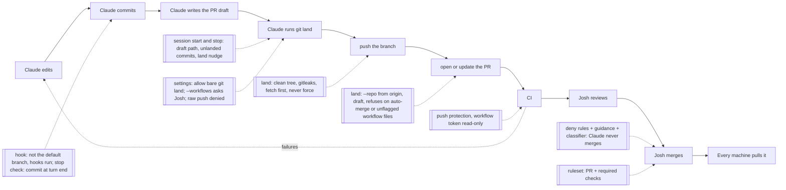
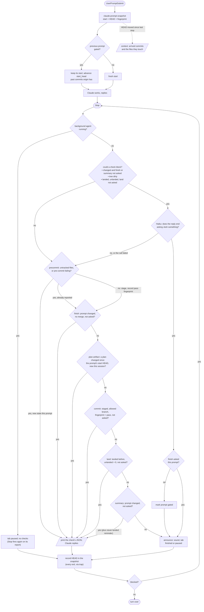

# Letting Claude commit and push

Artifact: https://claude.ai/code/artifact/4b4cec3a-a837-456b-9d3d-c3b77c2f1a0c

This plan covers how work Claude Code does reaches GitHub:
who commits, who pushes, what guards each step, and what those guards can
and can't promise.
It argues from the threat model to the mechanism, because the mechanism that
fits depends on which mistakes it has to stop.

It lands in increments.
The first increment lets Claude commit, and land its own work through one
narrow command, `git land`, which pushes the current branch and opens or
updates a draft pull request, and does nothing else.
Josh reviews and merges.
That is most of an unattended PR fixer already: Claude commits, lands, reads
CI, fixes, and lands again.
Its guards hold against honest mistakes, not against an agent routing around
them (see the threat model), and it leans on good guidance and the secret
controls in decisions 4 and 5.
The direction after that, an exe.dev VM whose boundary is structural rather
than a set of rules in the harness, answers the rest.
It is sketched here so the context stays together, and gets its own design when
it's next.

Out of scope:

- Letting Claude merge, approve, or publish a release, anywhere. Those stay
  Josh's, even when asked for in the moment.
- Defending against a hostile agent, such as one steered by prompt injection.
  Nothing in the first increment depends on that, and the agent-box direction
  happens to cover much of it.

## The question

What would have to be true to stop treating commit and push as the line
Claude never crosses, without losing the property that line protects: nothing
reaches a default branch that deploys, or the public, without Josh having looked
at it?

The answer this plan argues for: the line moves from push to merge, in two
steps.

- Now: Claude commits on worktree branches and lands them with `git land`, a
  fixed command whose checks are deterministic, while raw `git push` and every
  `gh` write stay denied. Josh reviews at merge, which is where he actually
  looks (decision 3). The harness guards hold against honest mistakes only.
- Next: the same workflow on a VM built for one task, holding a credential for
  one repo, so what holds the line is the VM and GitHub's rules rather than
  rules in the harness.

## Responsibility and identity

Josh takes responsibility for the work in his repos, whether he typed it or
asked Claude to.
Claude is a tool like an editor or a formatter, and using it isn't something to
hide or to announce on every commit with an attribution trailer.
Context about how the work was done, such as the PR description's fold naming
the model (decision 2), is a different thing, and is fine to land in a squashed
commit's message.
That settles three things the rest of the plan depends on:

- Commits are authored as Josh, pushes and pull requests arrive as Josh, and
  no trailer marks them as Claude's.
- Giving Claude a separate GitHub identity (a bot account, or an app acting as
  itself) is the wrong fix, because it would make the record say someone other
  than Josh is responsible.
- Narrowing what Claude's credential _can do_, while it still acts as Josh,
  is the right kind of fix.

The identity choice has a cost the plan returns to more than once: GitHub can't
tell Claude from Josh, so nothing server-side can stop Claude merging what Josh
could merge.

## Why now

Starting work from the phone already works: `manage-worktrees serve` opens a
worktree with Claude in it from a web form, and the zellij web client steers it.
Landing that work is the one step that still needs a desk, because today it
means a terminal running `git commit` and `git push` by hand.

Commit and push are separate decisions with different costs, so this plan treats
them separately:

| | Undo | Who sees it | Cost of a mistake |
|---|---|---|---|
| Commit on a worktree branch | `git reset`, local only | Nobody | Minutes of cleanup |
| Push a branch to a private repo | Delete the branch | Josh | Small |
| Push a branch to a public repo | Not possible for content; GitHub caches and indexes it | Everyone | A leaked secret must be rotated, private content is out |
| Land on a default branch | Revert, but it may already have deployed | Every machine | Bad code runs everywhere |
| Publish a release | Not possible; a PyPI version can only be yanked | Everyone, and every dev box by the next day | Bad code installed everywhere |

## The threat model

The mistakes worth designing against come in three levels, and each needs a
different kind of guard.

| Level | What it looks like | What stops it |
|---|---|---|
| 1. Honest mistake | Commits on the wrong branch, pushes too early, puts a secret or private context in a diff, targets the wrong remote. Uses the natural command, and stops when told no. | Guidance, prefix deny rules, a thin hook, server-side rules |
| 2. Overdetermined | Blocked, it finds another route: `bash -c`, `git -c`, a Python script that calls the API. Not hostile, but routes around guards to finish the task. | A boundary where the other route doesn't exist: a credential that isn't present, a VM, a server-side rule |
| 3. Hostile | Steered by prompt injection or a compromised dependency; evades on purpose and exfiltrates | The same boundaries as level 2, held more strictly |

Level 2 is real behavior, not a hypothetical: an agent told a push is denied
and asked to finish the task will try the next spelling.
A guard that parses commands can't hold against it, because a shell is a
programming language and the parser sees only text.
It catches the first workaround or two and loses the race after that.
A boundary built for level 2 covers most of level 3 for free.

### What each guard is reviewed against

A guard in this plan is reviewed against the level it claims, and every guard
says which.
Harness guards (deny rules, hooks, guidance) claim level 1: each must catch the
natural spelling of an honest mistake.
A spelling that gets past one is not a finding against it, because no parser
can close that gap.
A finding against a level-1 guard is a _natural_ mistake it misses.
Where level 2 matters, the plan names a boundary that holds, or says that none
does.

## What's true today

All of this was read from the live config, the Claude Code 2.1.325 binary,
GitHub, and exe.dev between 2026-11-10 and 2026-11-15, or measured with the
probes in phase 0.

### In the harness

- `claude/settings.json` denies `Bash(git commit*)` and `Bash(git push*)`, and
  the global `CLAUDE.md` says the same in prose, with an exception for merge
  commits that need no judgment.
- Those deny rules are narrower than they look. A probe found that
  `git -c k=v commit`, `git -C . push`, and `bash -c 'git push …'` all get
  past them, while `env git push`, `VAR=x git push`, and `cd . && git push`
  are caught. That's a level-2 gap, which no deny rule closes.
  `claude-git-dash-c-check` happens to refuse `git -C` aimed at the current
  repo, so in the real config only `-C` with a path to another clone gets
  through; `git -c` and `bash -c` are unaffected.
- `defaultMode` is `auto`. The auto-mode classifier's defaults (from
  `claude auto-mode defaults`) treat a push to _any_
  branch of the session's repo as ordinary, the default branch included. It
  blocks force pushes to shared branches, merging a PR no human approved,
  approving Claude's own PR, secrets or private content headed for a public
  repo, and commits that arm a CI pipeline to leak a secret. Those are model
  judgments, not string matches: useful, and not a guarantee. In headless probe
  runs it let through both a force push and a request to upload an SSH key,
  each in a sandbox where the prompt said the user wanted it.
- `gh pr merge` and `gh release create` aren't denied; only the classifier
  stands in front of them.
- `claude-redact-secrets` masks secret-shaped strings in tool output before the
  model sees them, which lowers the odds of a secret being copied into a file in
  the first place.
- The only secret-shaped pre-commit check in dotfiles is `detect-private-key`.

### What Claude is told today

- Claude Code's own git sections are off: `includeGitInstructions: false` in
  `claude/settings.json`. When on, they say "Only create commits when requested
  by the user. If unclear, ask first.", "NEVER commit changes unless the user
  explicitly asks you to", and "DO NOT push to the remote repository unless the
  user explicitly asks you to do so", along with a safety protocol (never update
  git config, never skip hooks, prefer new commits over amending).
- The harness's system prompt keeps one general line that applies:
  "For actions that are hard to reverse or outward-facing, confirm first unless
  durably authorized or explicitly told to proceed without asking; approval in
  one context doesn't extend to the next."
- Sessions started from claude.ai or Remote Control can carry a host-set
  proactivity level. At `default` it says "Do not create git commits, push to a
  remote, or create or update pull requests unless the user explicitly asks or
  confirms." At `proactive` it says "Commit, push, and create or update pull
  requests without asking whenever that is the natural next step of the task."
  `ask` is stricter than `default`.
- The global `CLAUDE.md` says "Don't create git commits or push changes on my
  behalf", with the clean-merge exception.

### Credentials

Every machine pushes as Josh. On an exe.dev dev box, git and `gh` go through
exe.dev's GitHub integration: the VM talks to `github.int.exe.xyz`, and exe.dev
injects the credential at its proxy, so no token sits on the VM
([exe.dev docs](https://exe.dev/docs/integrations-github.md)).
Integrations are created per repo, attached to a VM, a tag, or every VM, and
can act as Josh (`--act-as-user`) or as exe.dev's app, and be `--readonly`.
Elsewhere it's a `gh auth login` token or Josh's SSH key.
Either way, a push or a merge by Claude _is_ a push or a merge by Josh as far as
GitHub can tell, which is the accurate record (see above).

What the credential may do differs by kind.
A `gh auth login` OAuth token with the `repo` scope administers the repo,
rulesets included.
The exe.dev integration is a GitHub App user access token: it acts as Josh, and
has only the permissions both Josh and the app have.
Probing it, every endpoint that needs `administration=read` (branch protection,
default workflow permissions) and `secrets=read` answered
`403 Resource not accessible by integration`, so it can't change rulesets, repo
settings, or secrets either.
It can push, and since GitHub requires the same `Contents: write` for merging a
pull request and for creating a release as for pushing
([permissions table](https://docs.github.com/en/rest/authentication/permissions-required-for-fine-grained-personal-access-tokens)),
it can do those too.

That decides what the server side can do. A ruleset can't treat Claude
differently from Josh, and requiring an approval doesn't help either: GitHub
doesn't let a PR's author approve it, and as the sole maintainer of these hobby
and solo projects, Josh has nobody else to give one.

### What a session on the dev box can reach

Push is a small part of what a Claude session on the dev box can touch.
`curl https://reflection.int.exe.xyz/integrations` lists what is attached:
a write-capable, act-as-user GitHub integration for nearly every one of Josh's
repos, plus HTTP-proxy and catalog integrations for Cloudflare, Fly, and
SimpleFIN.
Any process on the VM reaches all of them; integrations are per VM, not per
Unix user.
The box also holds the git stash shared by every worktree, every other
session's worktrees, and the zellij session Josh steers from.
Several existing hooks (`claude-rm-scope-check`, `claude-git-dash-c-check`)
exist because of that sharing, and they too are level-1 guards.

That is the convenience of a shared dev box and its cost, and it's why the
structural boundary for unattended work is a separate VM rather than a hardened
dev box.

### On GitHub

Default-branch rules for Josh's public repos with a clone on this box:

| Repo | Default-branch rules | Approvals required |
|---|---|---|
| dotfiles | no deletion, no force push | (no PR rule) |
| counterweight | + PR, status checks | 0 |
| claude-scriptorium | + PR, status checks, Copilot review | 0 |
| exe-dev-atlas | + PR, status checks | 0 |
| evp | + PR, status checks | 0 |
| waxy | + PR, status checks, linear history | 0 |
| without | + PR, status checks | 0 |
| ray (fork) | none | (no PR rule) |
| room (fork) | none | (no PR rule) |

The private repos split the same way: the ones that ship something have the PR
rule, and the spikes and demos don't.

The PR rule guarantees a PR exists and CI passed. With approvals at 0, it
doesn't guarantee anyone looked: anything holding Josh's credential can open a
PR and merge it once checks are green.
The repos with no PR rule other than dotfiles are unprotected on purpose: forks,
spikes, and demos, where a push to the default branch landing directly is the
point.

Whether GitHub secret scanning and push protection are on for these repos is
unknown, as are each repo's default `GITHUB_TOKEN` permissions and whether
Actions may create and approve pull requests: the exe.dev integration can't read
any of them.
Dotfiles' only workflow sets `permissions: {}` and grants its one job
`contents: read`.
Dotfiles has squash merging allowed and auto-merge off.

A published release is a deploy in seven repos: all six public repos above with a
PR rule, and one private one. Each runs a workflow `on: release: [published]`,
and the ones read for this plan upload to PyPI through trusted publishing.
exe-dev-atlas and claude-scriptorium are also what every dev box converges to
the next day, with the mise cooldown waived for them.
Their `pypi` environments have a branch policy and no required reviewer.

pre-commit.ci runs on dotfiles with `autofix_prs` at its default, so it pushes a
fix commit to any PR branch whose hooks changed files. A pushed branch can
therefore gain a commit the local clone doesn't have.

### Why dotfiles master is special

Pushing to dotfiles `master` is a deploy, not a code change. `sync-branches`
fast-forwards every local branch on every machine hourly, and every bot-box runs
`git pull --ff-only && ./install.sh` daily. What lands there runs in every
shell, every Claude Code hook, and `claude-shell`, which every Bash call passes
through. A bad `claude-shell` breaks every session on every machine at once.
That is why dotfiles moves to PRs only (decision 5).

## Where enforcement can live

The tools available differ less in strength than in which way they fail.
A guard that **fails open** lets through whatever it didn't anticipate: a
spelling the parser doesn't know runs.
A guard that **fails closed** refuses whatever it didn't grant: a spelling
nobody thought of still lacks the credential, the network route, or the
server's permission.

| Tool | Runs in | Fails | Sees | Where available |
|---|---|---|---|---|
| `deny` rules in settings | Harness | Open | The command as written | Every machine |
| PreToolUse hook | Harness | Open | The command as parsed; nothing a script does once it runs | Every machine |
| Auto-mode classifier | Harness | Probabilistic | Content and intent | Every machine |
| Guidance (`CLAUDE.md`, rules) | The model | Open | Whatever the model weighs | Every machine |
| Claude Code sandbox | OS (bubblewrap on Linux) | Closed | File paths, and network by domain | Every machine; unprobed here |
| Credential scope | GitHub | Closed | Every program holding the token | Depends on the credential |
| exe.dev integration attachment, `--readonly`, step-up approval | exe.dev's proxy | Closed | Every request from the VM | exe.dev |
| exe.dev egress policy | exe.dev's network | Closed | Every outbound connection | exe.dev |
| A separate VM | The hypervisor | Closed | Everything | exe.dev, or any other VM |
| Rulesets, push protection, workflow token settings | GitHub | Closed | Every write, whatever sent it | Every repo |

Two details shape what the closed guards can do here:

- The sandbox filters network by domain, and on exe.dev each credential sits
  behind its own `*.int.exe.xyz` host, so denying a host removes that
  credential from sandboxed commands. GitHub is the exception: every repo's
  integration shares `github.int.exe.xyz`, and fetch and push go to the same
  host, so the sandbox can't allow one repo or one direction without the other.
- Step-up approval makes an integration serve a VM only after Josh approves it
  for a chosen duration
  ([docs](https://exe.dev/docs/integrations-step-up.md)), which is a human gate
  on the credential itself, at the granularity of a VM and a time window rather
  than an action.

The harness tools are the only ones available on every machine, which is what
makes a parser tempting (alternative A below).
They are the right tools for level 1 and the wrong ones for level 2.

## Requirements this plan doesn't have

- **The same boundary on every machine.** The motivation is landing work from
  the phone, and the phone steers exe.dev boxes, so the structural direction
  may depend on exe.dev. `git land` works on every machine anyway, because it's
  git and `gh`.
- **A human at every push.** A gate protects only where Josh looks, and he looks
  at merge (decision 3 has the argument). Pushing a branch and opening a draft
  PR is reversible except where it publishes, and what publishes has controls
  of its own (decisions 4 and 5).
- **One identical setup on every box.** Different boxes can carry different
  tools: a dev box keeps its conveniences and its level-1 guards; an agent box
  gives up the conveniences for a boundary that holds at level 2.

## The approach



| | Claude commits | Who pushes and opens the PR | What holds the line |
|---|---|---|---|
| Any machine, first increment | On worktree branches | Claude, with `git land`; `--workflows` asks Josh | The PR rule and Josh's merge; level-1 guards around Claude |
| Agent box, next increment | On its branch | Claude | The VM, its attached integrations, and GitHub's rules |

## Decisions

### 1. Claude commits on any branch but the default

Claude commits on a worktree branch without waiting to be asked. It's local,
`git reset` undoes it, and reviewing a commit is no harder than reviewing a
working tree.

The hook, `claude-git-commit-check`, is a level-1 guard:

- Deny a commit on the repo's default branch, read from
  `git symbolic-ref refs/remotes/origin/HEAD`, which is local and costs no
  network call. A repo with no `origin` has nowhere to push, so a commit is
  allowed on any branch, which covers a `git init` scratch repo. A repo with an
  `origin` and no `origin/HEAD` is refused, with a message saying Josh needs to
  run `git remote set-head origin --auto`.
- Deny a commit on a detached `HEAD`, which has no branch to land.
- Deny `--no-verify` and `-n`, so pre-commit runs.
- Treat the other commands that create or rewrite commits (`git merge`,
  `git pull`, `git cherry-pick`, `git revert`, `git am`, `git rebase`) the same
  way for the branch check.
  What the check asks about a pull or a merge is where the branch ends up, not
  which command moved it.
  One that only fast-forwards the branch to its own upstream is allowed
  anywhere: `git pull` and `git pull --ff-only` naming no ref (with `pull.ff`
  at `only`, as Josh's gitconfig sets it), and `git merge --ff-only` naming
  `@{u}` or `origin/<this branch>`, which is how a branch syncs after a fetch.
  A pull or merge naming any other ref gets the branch check, `--ff-only` or
  not: `git pull --ff-only origin feature` on the default branch fast-forwards
  it to `feature`, and `git land` would then push that without a PR wherever
  there's no PR rule.
- Allow `--amend` and a commit that concludes a merge, conflicts resolved by
  Claude included. A messy merge on a branch is reviewed with the rest of the
  PR and squashed away on merge. Not amending a pushed commit is guidance:
  rewriting one would need a force push, which nothing in this plan makes.

It deliberately doesn't parse `git -c`, `GIT_CONFIG*`, `SKIP`, `bash -c`, or
`git -C`: those are level-2 routes, and the commit is local, so the push is the
step that matters.

**When Claude commits: at the end of each turn that changed files**, unless the
turn ends on a question or an offer to Josh, where decision 7's question gate runs no
checks at all and the next turn's commit picks the changes up.
The alternative, committing when Josh says so, puts a step on Josh that he'd
take after nearly every turn anyway, typed on a phone, and lets uncommitted
work pile up across turns where a later turn can't tell what's settled.
Turn-sized commits are noisy, and squash merges absorb the noise: the PR title
and body are what survives on the default branch.

A new stop check, `claude-stop-commit`, carries it. It runs in `claude-stop`'s
sequence after `claude-stop-precommit` has staged tracked changes and run
pre-commit and after the finishing pass and the plan page have settled, so the
commit holds the turn's final state, and before `claude-stop-land` and the
report (decision 7):

- `claude-stop-precommit` records a **pass fingerprint** under the git
  directory whenever it passes: no untracked files, tracked changes staged,
  and pre-commit green (or no pre-commit config). It's the change-set
  fingerprint the prompt snapshot uses (decision 7), taken after the autofix
  pass.
- When tracked changes are staged on a branch decision 1 allows, and the
  current fingerprint matches the recorded pass, `claude-stop-commit` blocks
  once per prompt (keyed on `prompt_id`, as `claude-stop-finish` is) and asks
  Claude to commit them with a message describing the step.
- The pass condition matters because `claude-stop-precommit` reports each state
  once per prompt and is silent after that, whether the state is a pre-commit
  failure or an untracked file, and on an untracked file it neither stages nor
  runs pre-commit. Without it the sequence would reach this check over a state
  pre-commit never passed, and ask for a commit the git hook refuses or one
  that leaves the stray out unsettled. Reading the record, rather than running
  pre-commit again, keeps a stop to one pre-commit run. A state with no pass
  carries its changes to the next turn, as a question turn does.
- After a commit the working tree is clean, so the stop that follows finds
  nothing for the checks before this one or for this one;
  `claude-stop-land` and `claude-stop-summary` decide whether it ends.

The cost lands on review. The diff review tool Josh uses reads uncommitted
changes, and turn-end commits leave nothing uncommitted between turns, so the
commit-range view ("Reviewing pushed commits" below) is needed from phase 2,
not later. Until it exists, `git diff <default>...HEAD` in a terminal, or the
PR's diff on GitHub once landed, is the review surface.

Turn-end commits also change what `sync-branches` does. It leaves a worktree
alone only while a tracked file has changes, so a worktree Claude committed in
is clean between turns, and once the branch has an upstream (after the first
land) the hourly run fast-forwards it to whatever pre-commit.ci or Josh pushed,
moving files under an idle session. That's what Claude would have done with
`git pull --ff` anyway, so neither `sync-branches` nor the stop checks change
for it.
Commits that arrive from `origin` between prompts are never a turn's work: a
fresh snapshot (decision 7) starts after them, and a carried-forward one
advances its starting `HEAD` past them whenever every commit between the two is
one `origin` has.
Nothing already tells Claude they arrived, since `claude-git-status` runs only
at session start, so `claude-prompt-snapshot` does: it compares `HEAD` with the
one the previous prompt's last stop recorded, and when they differ it adds the
new commits' subjects to the prompt's context, with a line saying the files
they touch have changed since Claude last read them.
A session that's idle for good never looks again, and loses nothing.
A run that lands mid-turn, while the tree is clean and the branch isn't ahead
of its upstream, counts as the turn changing `HEAD`, which costs at most one
extra report.

Cost: spikes that took direct pushes to their default branch now get Claude's
work as a PR from a branch. Josh can still commit on a default branch himself,
and `git land` pushes it. A per-repo opt-in for Claude committing on the default
branch is a knob to add if the PR per change turns out to be friction.

### 2. `git land`: one command that lands a branch

`bin/git-land` is a git subcommand on PATH, the way `git-disk-usage` is, so it
runs as `git land` with no alias.
Claude runs it through its Bash tool (decision 3 says when).
Josh can run it from any terminal too, or as `! git land` in a terminal
session, and it behaves the same.

Land takes no input once it starts: the Bash tool gives it none, and neither
does `!`. Every check passes, refuses with a message saying what to do next, or
is overridden by a flag given up front, and decision 3 decides who may give
which flag.

**Where the title and body come from.** Claude writes a draft in the shape of a
commit message: the title on the first line, a blank line, then the body.
It lives at `git rev-parse --git-path land/<branch>/pr.md`, which resolves per
worktree inside the git directory, so it's never committed, needs no ignore
entry, and goes away with a linked worktree.
The branch in the path, and in the path of the last-landed copy beside it,
keeps a branch switch within one worktree (the main clone's especially) from
opening the next branch's PR with the last one's draft.
A branch name can outlive its branch, though: in the main clone, a branch
deleted after its PR merged and later recreated finds the old directory still
there.
So land also records there the commit it last pushed, and a directory whose
recorded commit isn't in `HEAD`'s history belongs to an earlier branch of that
name.
`claude-git-status` and `claude-stop-land` then treat the branch as never
landed, and land, before using it, moves the directory aside to
`land/<branch>.old` and refuses, saying the draft may be the earlier branch's
and Claude should write one for this branch.
When Claude had already written this branch's draft, that costs one rewrite,
in a case that needs a reused name in the main clone.
`git land --path` prints that path, so Claude never derives it.
The body holds everything Claude wrote (the problem, the change, how it was
checked) inside a `<details>` fold, with the model and effort level as the
`<summary>`, such as `<summary>Claude Opus 5.5, high effort</summary>`, following
[Simon Willison's details-summary pattern](https://simonwillison.net/2026/Nov/9/details-summary/).
Claude writes the fold itself, since only Claude knows which model and effort
it ran at.

**On every run:**

1. Refuse when tracked files have uncommitted changes, since what lands is the
   commits.
2. `git fetch origin`, so the range below and the fast-forward check use fresh
   refs.
3. Run [gitleaks](https://github.com/gitleaks/gitleaks) over the
   **unlanded commits**, the ones `origin` lacks
   (`git rev-list HEAD --not --remotes=origin`), and stop on a finding.
   That range is exactly what the push publishes, so it covers commits
   pre-commit never saw, such as a merge or a cherry-pick, and commits that
   exist on another remote but not on `origin`, such as a private one's.
   It's also the range `claude-git-status`, `claude-stop-land`, and the
   question gate (decision 7) count, so land and the hooks agree on what's
   unlanded.
   In a fork whose `origin` lags `upstream`, it includes upstream's commits,
   which is right: the push publishes them to the fork, and a workflow file
   among them runs there with the fork's token. The cost is a refusal Josh
   clears with `--workflows` when upstream changed a workflow.
   The scan is `gitleaks git --log-opts="HEAD --not --remotes=origin" --redact`.
   It reads `git log -p -U0`, which shows no diff for a merge commit, so
   content introduced only while resolving a merge's conflicts isn't scanned
   (the merged branch's own unlanded commits still are), and the workflow-file
   check below has the same blind spot.
4. Refuse when that range touches `.github/workflows/` or an
   `action.yml`/`action.yaml`, unless run as `git land --workflows`, and list
   the files: a same-repo branch's `push` and `pull_request` runs get the repo's
   secrets and token before anyone reviews. `--workflows` is Josh's to approve
   (decision 3).
5. `git push -u origin HEAD`, never forced. A non-fast-forward rejection (a
   pre-commit.ci autofix, Josh pressing "Update branch", a push from another
   machine) stops land with a message, and Claude runs `git pull --ff`, which
   merges. A bare `git pull` doesn't: with `pull.ff` at `only` it aborts on a
   diverged branch.

**When the branch has no pull request:**

- Read `<host>/<owner>/<repo>` from `origin`'s push URL and run
  `gh pr create --repo <that> --head <branch> --title … --body-file …`.
  Naming the repo means a fork's clone never opens a PR on its parent, where
  `gh` would otherwise resolve.
- Wrap the body between `<!-- land:start -->` and `<!-- land:end -->`, which
  render as nothing, and save a copy of the draft as the last one landed.
- Always open it as a draft. Marking it ready is one click in the GitHub UI,
  and a draft doesn't request reviews or notify anyone, which matters in a
  repo other people watch, such as at work.
- In a fork (`origin` has a parent), push and open no PR; Josh opens the
  upstream PR himself.
- On the default branch, push and open no PR. GitHub refuses the push where the
  repo has a PR rule, which is the rule doing its job.

**When the branch already has a pull request** (from
`gh pr view <branch> --repo … --json state,title,body,autoMergeRequest`):

- Merged or closed, and this branch's: stop and say so, since commits pushed
  there land nowhere.
  A PR is this branch's when its head, fetched from `refs/pull/<N>/head`
  (which GitHub keeps after the branch is deleted), shares a commit with
  `HEAD` that the default branch lacks.
  Asking whether the head is in `HEAD`'s history would misread a PR whose last
  commit came from pre-commit.ci or another machine and was never pulled.
  A merged or closed PR that shares nothing with `HEAD` belongs to an earlier
  branch of the same name, and counts as no PR.
- Auto-merge armed: refuse before pushing, since the push would merge once CI
  is green. The way through is for Josh to turn auto-merge off on the PR, then
  land again.
- Draft changed since the last land: replace only the text between the markers
  in the live body, keeping anything Josh wrote outside them, such as an opener
  of his own. Update the title only if the draft's title changed, so a title
  Josh edited on GitHub survives an unrelated land.
- Draft unchanged: just push. Adding commits to a PR never needs the draft
  touched.
- No local draft (the PR was opened from another machine or worktree, or the
  draft was deleted): leave the body alone, and write the live text between the
  markers into the draft path, so Claude starts from what the PR says.

That makes the draft Claude's handle on its part of the PR description, for the
life of the PR: Claude edits the draft whenever the change moves, and the next
land carries it to GitHub. Josh's text outside the markers is never Claude's to
touch, and Claude never needs `gh pr edit` to update its own.

**Land's messages say who acts next.** Claude usually runs it and reads its
output, and Josh reads the same output in the session, so each refusal names the
next step and who takes it: "rejected as non-fast-forward: run `git pull --ff`,
then land again", or "auto-merge is armed on #12: Josh has to turn it off on the PR
before this branch can land. Claude, stop here and say so."

**When `gh` can't read the host** (a laptop pushing over SSH with no
`gh auth login`), land refuses before pushing. Pushing without the auto-merge
lookup could merge a PR armed from another machine, and opening the PR needs
`gh` anyway. Josh pushes by hand there.

Every check in land is deterministic, and runs the same whoever invokes it.
What land can't check is whether Claude went around it, which is level 2
(decision 3).

### 3. Claude lands its own work, through `git land` only

The commit bullet in the global `CLAUDE.md` becomes a durable authorization,
worded as one so the harness's "unless durably authorized" clause applies:

- Commit on a worktree branch without waiting to be asked, once pre-commit
  passes.
- Bring a branch up to date by merging the base branch in, never by rebasing.
- Don't amend a commit that has been pushed, unless Josh asks for it
  explicitly; land never force-pushes, so pushing the rewrite is his.
- Commit at the end of each turn that changed files, unless the turn ends on
  a question or an offer to Josh.
- Once the change is worth showing (a coherent first version whose checks pass
  locally), write the PR draft to the path `git land --path` prints, and run
  `git land`. After that, land again at the end of each turn that committed, so
  the PR and its CI stay current.
- Rewrite the draft whenever what the PR is has changed. It's the only way to
  change Claude's part of the PR description.
- After landing, wait for the PR's checks without polling, with
  `gh pr checks --watch --fail-fast` in the background (started again if
  the runs haven't registered yet), then read what failed
  (`gh run view --log-failed`) and fix it.
- Push only through `git land`, and never pass it `--workflows` without Josh
  approving that run. Never open or edit a pull request directly, merge,
  approve, enable auto-merge, or publish a release, even when asked to in the
  moment. Say that Josh has to, and stop.
- When a guard or a land refusal blocks something, say so and stop. Don't look
  for another route to the same effect.
- Committing and landing are what put text in the public record, so when
  unsure whether something belongs there, ask before committing (decision 4).

The settings back that with level-1 rules:

- `allow` gains `Bash(git land)` and `Bash(git land --path)`, so the bare
  command runs without the classifier deciding.
- `ask` gains `Bash(git land --workflows*)`, a real prompt in auto mode.
- `deny` keeps `Bash(git push*)` and gains `Bash(git-land*)` (so the hyphenated
  spelling can't carry `--workflows` past the `ask`), `Bash(gh pr create*)`,
  `Bash(gh pr edit*)`, `Bash(gh pr merge*)`, `Bash(gh pr review*)`, and
  `Bash(gh release create*)`.
- `Bash(git commit*)` leaves `deny`, and the hook from decision 1 decides.

Whether the authorization holds under a host-set `default` proactivity level is
untested, and matters, since Claude now lands; phase 0 lists it.

#### Why Claude runs it, rather than Josh running or approving it

Three ways to keep Josh at each push were weighed.

- **Josh types `! git land`.** `!` works only in the terminal interface. From
  claude.ai on the web, the mobile app, or Remote Control, a line starting with
  `!` "goes to Claude as a message and doesn't run in shell mode"
  ([Remote Control docs](https://code.claude.com/docs/en/remote-control.md)),
  and a `! echo hi` sent that way arrived as plain text. The zellij web client
  is a terminal, so it works there and nowhere else remote.
- **A user-only `/land` skill** (`disable-model-invocation: true`) running land
  through the skill's `` !`…` `` shell injection. From a claude.ai client the
  injection is checked against `deny` and then handed to the model to run
  through its Bash tool (phase 0), so it comes back to Claude running it.
- **An `ask` on every land.** Permission prompts reach every client, so this
  one works everywhere.

All three fail the same way, and the third shows it most plainly.
A prompt that reads `git land` every time carries nothing to judge but "Claude
thinks it's ready", so approving it becomes a reflex, and typing `! git land`
whenever Claude says so is the same reflex with more keystrokes.
Running it has one real edge over approving it, which is choosing the moment,
and that's worth something only if Josh looks at the change first.
A gate protects only where Josh looks, and he looks at merge.
At the push, what's at stake is publication on public repos, and what publishes
(a secret in a diff, private context in a commit message or PR text) isn't on
screen when he lands. gitleaks, push protection, and the public-record rule are
what guard it.

That gives the rule for a human gate in this plan: **stop for Josh only where
the case is rare and the prompt shows something to judge.** Frequent prompts
with nothing to judge train the reflex that then approves the rare case too.
`--workflows` qualifies: it's rare, and land lists the files. A routine land
doesn't.

Letting Claude run land adds no level-2 exposure: Claude can already route
around `Bash(git push*)` with `bash -c`, and land is a narrower capability than
the push it wraps. It does put Claude near the push more often, so it meets
refusals more often, and a refusal is where an overdetermined agent looks for
another route. Land's messages and the stop-when-blocked guidance are the only
answer to that, at level 1.

**The bet** is that Claude, told to use one named workflow, to trust it, and
not to work around it, does so.
The evidence so far is that under today's `deny` on commit and push, Josh
hasn't noticed Claude routing around either.
Not noticing isn't the same as not happening, so phase 3 checks the
transcripts, and the bet is cheap to lose: if Claude does route around land,
that's the signal to move unattended work onto agent boxes sooner, not to grow
a parser.

Cost: on a public repo, non-secret private context Claude writes is published
before Josh sees it, guarded only by the public-record rule and the classifier.
That was already true of an approval given by reflex.

#### How Claude knows where the landing stands

The doctrine (commit at turn end, land through `git land`, keep the draft
current) changes what Claude does, so it's in the global `CLAUDE.md`, which
loads in every session. Where a given branch stands is true only at a point in
time, so hooks compute it rather than anyone writing it down:

- **At session start**, `claude-git-status` adds the branch's land state, all
  local and with no network call: the draft path, whether a draft exists,
  whether it has been landed before (land's saved copy), whether it changed
  since, and how many unlanded commits it has (decision 2).
- **At session start**, `claude-gh-status` already reports an open PR. For a
  branch land opened, it adds that Claude's part of the body is the text between
  the land markers, carried from the draft on the next land.
- **At stop**, a new check `claude-stop-land` runs after `claude-stop-commit`.
  When the branch has been landed before and has unlanded commits,
  it blocks once per prompt and asks Claude to land them, rewriting the draft
  first if they change what the PR is, or to say in one line why not. A
  branch that has never been landed earns only a reminder that the change
  lands once it's worth showing. A Stop hook's `additionalContext` always
  costs a model turn, so the reminder rides on `claude-stop-summary`'s request
  for the report, the one turn spent anyway. Like every check, neither runs on
  a turn that ends on a question or an offer to Josh (decision 7).

### 4. What stays out of the record

Secrets are the case a scanner can catch. The larger case is context Josh gives
Claude that he doesn't want in a commit, a PR, or a code comment:
timelines, other projects (private ones especially, including their names),
the order things will happen in, and decision criteria that rest on private
business information.
No scanner can see provenance, so this is guidance, in a new path-less rule
`claude/rules/public-record.md`. It loads unconditionally because it changes
what Claude writes.

It says, in short:

- Anything that lands in a repo or on GitHub (commit messages, PR and issue
  text, code comments, docs, plans) is written for everyone who can read the
  repo, and context goes in only if all of them could already see it. A public
  repo's readers are everyone; a private work repo's are the organization, so
  naming another of its repos passes there. Readers widen, so an uncertain
  audience is treated as the wider one.
- What belongs there is what those readers need: the change, the reason, the
  evidence. Context from the conversation they couldn't already see stays in
  the conversation.
- In a public repo, name another project only if it's public and the change
  depends on it.
- When unsure, ask before committing, rather than writing it and hoping.

Nobody rereads every commit message before it lands, so the rule carries the
weight, alongside the classifier's content rules.

### 5. Server-side settings

These fail closed, hold whatever ran in the harness, and stay right in every
increment:

- Dotfiles gets the PR rule with approvals at 0 and the `pre-commit` workflow
  as a required status check, so a broken hook self-test blocks the merge.
  GitHub names a workflow's check after its job, so the required check is
  `pre-commit`, as the `pull_request` run reports it.
  One command, `git yeet` (`bin/git-yeet`), keeps Josh's own quick changes
  cheap: it refuses on any uncommitted or untracked change, pushes the branch,
  then runs `gh pr create --fill && gh pr merge --squash --auto`. That needs
  auto-merge allowed in the repo settings; squash merging already is. It is on
  `PATH`, so it reaches Claude's shell too; `deny` lists both of its spellings
  alongside `gh pr merge`.
- Secret scanning and push protection on for every public repo. Push
  protection rejects a push containing a recognized secret before it lands.
- Default workflow permissions read-only in every repo, and "Allow GitHub
  Actions to create and approve pull requests" off, so a job gets write access
  only by asking for it in a workflow file.
- Each publishing repo's `pypi` environment requires Josh's review. It can't
  tell Josh from Claude, but it makes a release two writes rather than one.
- Actions secrets, where any are added, go behind an environment with required
  reviewers, out of reach of `push` and `pull_request` jobs.
- gitleaks in each repo's pre-commit, installed however that repo installs its
  pre-commit tooling, since a repo's pre-commit is shared with anyone who works
  on it.

### 6. Attribution

Commits are authored as Josh, with no trailer and no `Co-authored-by` line.
Today `claude/settings.json` sets `attribution` to `{"commit": "", "pr": ""}`,
which leaves `sessionUrl` at its default, so web and Remote Control sessions
still append a `Claude-Session:` trailer and a PR-body link. Setting
`"attribution": false` turns all three off.
The details-summary fold (decision 2) is where a PR says what Claude wrote.

### 7. The stop sequence ends with the report or the question

Each stop check that blocks makes Claude reply, and that reply becomes the last
thing Josh sees. Today a turn's report is often buried under
"Finishing pass: nothing to change." or a republished plan link, because
Claude writes the report before it knows a check will fire.
This plan adds two more checks (`claude-stop-commit`, `claude-stop-land`), so
without a fix the report sinks further on exactly the turns that matter most.
That makes this a prerequisite for the rest of phase 2, not a separate
nicety: it's what makes adding stop checks practical.

A question has the same problem from the other side. A turn that ends asking
Josh something, whether a question it needs answered or an offer of more work
("Want me to also…?"), wants that to be the last thing he reads, and every
check that fires after it buries it, or makes Claude answer the check with a
line declining it. Offers count: Josh often takes them up, and ending on one
says Claude isn't done with the work yet.

Three parts, all needed. Guidance alone would at best shorten the replies to
checks, with the report still above them; a final check alone would get the
report written twice; and without the gate, every check after a question needs
a declining line under it.

- **Guidance in the global `CLAUDE.md`**, so Claude knows the shape of what
  follows its reply before any check fires:
  - After a turn that changed tracked files, `claude-stop` runs checks, and the
    last of them asks for the turn's report. End the work with one line and
    hold the report; keep replies to checks short; write the report when asked.
  - When a reply ends on a question or an offer to Josh, write the report and
    the question together, now, with the question last. That holds for a
    reply to a check too, such as asking whether to suppress what pre-commit
    flags. A small model reads every reply, and when it ends asking Josh
    something no further check runs, so this message is what Josh reads, and
    whatever the checks hadn't reached yet (the commit, the land) waits for the
    next turn.
  - Make that question unmistakable: one direct question or offer to Josh, at
    the end. Don't close with one out of habit: a turn that ends on an offer
    leaves its work uncommitted and unlanded until Josh replies.
  - In a turn that changed nothing, such as a discussion, answer normally,
    since no check fires and a held report would never arrive.

  The checks' own messages carry their specifics, so the guidance doesn't
  repeat them. The gate is the exception: it acts by staying silent, so it has
  no message, and its whole contract lives in the guidance.
- **A question gate at the head of `claude-stop`**, before any check, with the
  cheap read first:
  1. Could any check block? The read is each check's own blocking condition,
     not a broader one: this prompt changed the repo (below), which the
     finishing pass and the report block on; tracked changes, which the
     pre-commit and commit checks block on; or unlanded commits on a branch
     that has been landed before, which `claude-stop-land` blocks on. A branch
     that has never been landed only earns a reminder, which needs no gate.
     If nothing could block, the sequence runs with no model call, which
     covers most discussion turns.
  2. Otherwise, hand `last_assistant_message` from the `Stop` payload to
     Haiku, asking whether the reply ends by asking Josh something, a question
     or an offer of more work. If it does, end without running any check.

     ```bash
     claude -p --model haiku --setting-sources "" --tools "" \
       --strict-mcp-config --no-session-persistence
     ```

     `--strict-mcp-config` with no `--mcp-config` starts no MCP servers, and
     `--no-session-persistence` keeps every gated stop from writing a
     one-message transcript into the session archive.

  It runs on every stop, including the ones after a check blocked, so a reply
  to a check that turns into a question ends the sequence there; the guidance
  above is what puts the report in that reply. A call that fails or exceeds its
  timeout counts as not a question, so the checks run as they would without
  the gate.
- **Why a small model, and why inside `claude-stop`**: `claude-stop` skipped
  its checks when the last message contained `?` from `2fe1dc0` until
  `4cbc74c` removed it, because a text heuristic misfired too often in both
  directions, and the main model has no structured way to say it's asking.
  Reading the reply is a model's job. A
  [prompt-based Stop hook](https://code.claude.com/docs/en/hooks.md#prompt-based-hooks)
  would be the obvious place, but phase 0 found it runs in parallel with
  command hooks in the same event, so it can't stop `claude-stop` from running;
  calling the model from inside `claude-stop` keeps the gate ahead of the
  checks, and lets the cheap read skip the call.
- **A gated turn's changes carry forward.** When the gate ends a stop before
  the finishing pass has asked this prompt (always so on the first stop, and
  so when pre-commit blocked first), it records in the prompt's snapshot that
  the prompt is gated.
  `claude-prompt-snapshot`, finding the previous prompt so marked, keeps that
  prompt's starting point instead of taking a fresh one, so the next turn's
  finishing pass and report cover the question turn's edits too. When `HEAD`
  moved after that prompt's last stop onto commits `origin` has (decision 1),
  the kept starting point advances to the new `HEAD`, so upstream's commits
  never read as the turn's own. `sync-branches` only fast-forwards a branch
  with no unlanded commits, so nothing the session committed is skipped
  except work already landed, whose report the question turn's reply carried.
  A gate that ends a stop after the finishing pass asked records nothing:
  the pass covered the turn's edits, and the reply it ended carries the report.
  `claude-stop-commit` and `claude-stop-land` need nothing either way, since
  they read state now.
- **Every stop records `HEAD`** in the prompt's snapshot, whichever way it
  ends, so the next prompt's snapshot can tell commits that arrived between
  prompts from ones the session made (decision 1).
- **A last stop check, `claude-stop-summary`**, at the end of `claude-stop`'s
  sequence. It blocks once per prompt when this prompt changed the repo, and
  asks for the report. A turn that ends asking Josh something never reaches
  it, so the report it asks for ends without a question.
- **What "this prompt changed the repo" means**, which the guidance and the
  check must agree on: `HEAD` or the change-set fingerprint differs from when
  the prompt arrived. A new `UserPromptSubmit` hook, `claude-prompt-snapshot`,
  records both under the git directory, keyed by `prompt_id`, with the
  fingerprint the retired `claude-changeset-guard` computed (the tracked diff
  against `HEAD` plus the untracked file list). Comparing `HEAD` as well matters
  because turn-end commits leave the tree clean.
- It keys on the repo, not on whether another check fired: a check that fires
  once per prompt can skip, and the report would go missing on that turn.
- **The finishing pass uses the same snapshot**, and `claude-changeset-guard`
  retires. That guard does two jobs today. One is keeping the finishing pass's
  own edits from triggering another pass, which `claude-stop-finish`'s
  once-per-`prompt_id` check already covers alone. The other is firing when the
  diff differs from the last one it nudged about, which answers a nearby
  question rather than the one wanted: Josh's own edits between prompts
  trigger it, and a turn that ended in a commit leaves it nothing to see. "Did
  this prompt change the repo" is the question both checks ask, so it's
  computed once. The guard's skip during a merge or rebase moves into
  `claude-stop-finish` alone, since the report must still be asked for on a
  turn that resolved a merge.
- **One once-per-prompt record.** Every check that asks once per prompt
  (`claude-stop-finish`, `-commit`, `-land`, `-summary`) records its ask in the
  prompt's snapshot through `claude-prompt-snapshot ask`, rather than in a
  marker file of its own, so the question gate can tell which checks could
  still ask.
- A prompt with no snapshot (a session older than the hook, or a failed write)
  counts as changed, so the cost of a gap is an extra pass rather than a
  missing report.
- `claude-stop-commit` and `claude-stop-land` don't use it: they ask about
  state now (staged changes, unlanded commits), whichever prompt left
  them, once per prompt.

#### The stop sequence, end to end

Every stop runs `claude-stop` from the top. A check that blocks makes Claude
reply, and that reply is another stop, so the diagram is a loop that ends only
at an announcement. Each check asks at most once per prompt (recorded through
`claude-prompt-snapshot ask`), except pre-commit, which reports each failing
state once per prompt, so the loop ends once the tree stops changing.

<figure class="wide">



</figure>

Three details the loop depends on, each easy to get wrong:

- "This prompt changed the repo" stays true for the whole prompt, so the cheap
  read pairs it with whether the finishing pass or the report could still ask.
  Without that, every reply to a check (the finishing pass, the commit, the
  land, the report itself) would pay for a Haiku call after every check had
  spent its one ask.
- The gated mark goes on whenever the finishing pass hasn't asked yet this
  prompt, not only on the first stop. A question in reply to a pre-commit
  failure would otherwise leave that turn's edits with no finishing pass at
  all.
- `claude-stop-plan-artifact` diffs against the prompt's starting `HEAD`, not
  `HEAD`, since a plan Claude committed mid-turn changed all the same.

Costs: one more model turn on every turn that changes the repo, and a Haiku
call of about 2s on every stop where a check could block. An
interrupt or a check that errors leaves no report, since Claude held it.
A question turn's edits wait a turn for their finishing pass, commit, and
land, and edits Josh makes while answering count as the next turn's. Because
offers count, that's a common case rather than a rare one, and work that ends
on an offer Josh never answers stays uncommitted on the box.
A misread either way stays recoverable: a question read as a plain report runs
the checks, as `claude-stop` does today, and a plain report read as a question
skips them, with the carry-forward bringing its edits into the next turn. Changes outside
the session's repo (the scratchpad, another clone) don't count, so a turn that
changed only those gets its report without the check asking, which the
guidance's "tracked files" wording has to match.

## Next: agent boxes for unattended work

The first increment already runs the PR fixer's loop (commit, land, read CI,
fix, land again), guarded at level 1.
What agent boxes add is a boundary that fails closed: against an agent that
does route around land, against levels 2 and 3, and against everything else a
dev-box session can reach.
They become pressing if phase 3 finds Claude working around land, or when
Claude is left running long enough that nobody would notice if it did.
This section records the shape the next design starts from; it isn't decided.

**The box.** One exe.dev VM per task or per repo, tagged (say `agent`), built
with the bot-box tooling `bin/exe-dev` already has. VMs on the Personal plan
share one capacity, up to 50 of them
([pricing](https://exe.dev/docs/billing/personal.md)), so an idle box costs disk,
not CPU.

**What the box can reach is the allow list.** Attach only the GitHub
integration for the repo the task is in, act-as-user, and nothing else that
holds a credential: no SimpleFIN, Cloudflare, or Fly. Alternative A's
per-machine YAML allow list of remotes would reimplement exactly this, as a
fail-open file the harness consulted; exe.dev's attachment does it at the
proxy. The box has no SSH key or `gh` token of Josh's to read, which is
what makes the narrower credential a boundary rather than a default.

**What Claude may do there.** The same workflow as the first increment, through
the same `git land`. What changes is what a workaround reaches: one repo's
credential, and nothing else. Default branches are held by GitHub: every repo
an agent box works on needs the PR rule first, which the repo checklist checks.

**What stays in the harness.** Merging, approving, and releasing need the same
`Contents: write` as pushing, so the credential can't separate them, and the
identity decision rules out an approval GitHub would count. On an agent box
those remain level-1 guards (deny rules, guidance, the classifier) against a
level-2 risk. Leads that might move them server-side, all unprobed:

- Events done through a GitHub App user token carry
  `performed_via_github_app`. If a label or similar signal added through the
  exe.dev app is distinguishable from one Josh adds in the web UI or mobile
  app, a required status check could pass only on Josh's own click, which would
  make merge-readiness something the integration can't produce.
- Step-up approval on the write integration, so a box can write to GitHub only
  inside a window Josh opened from his phone.
- A `--readonly` integration attached always and a write one attached on
  demand, if exe.dev resolves two integrations for one repo predictably.

**How Josh steers it.** A dev-box zellij tab can run
`exe-dev ssh <box> claude`, so the phone workflow stays the same while the
process and the worktree live on the agent box. `manage-worktrees serve` could
grow a form that does this.

**The dev box itself.** Claude keeps landing from the dev box through
`git land`, at level 1. Its non-GitHub credentials are still reachable from
every session there; the Claude Code sandbox, denying those `*.int.exe.xyz`
hosts, is the tool for that, as separate work.

**Questions the next design answers:**

- Does the exe.dev integration have `Workflows` write? If not, workflow-file
  changes can't be pushed from an agent box at all, which settles decision 2's
  workflow-file refusal structurally there.
- How a box gets its clone and branch, and when it's torn down.
- Whether `check-repo-setup` (below) gates attaching a repo's integration.

## Alternatives rejected

### A. A parsing hook that lets Claude push from every machine

The earlier version of this plan let Claude push and open PRs on any machine,
guarded by `claude-git-write-check`, a PreToolUse hook that parsed every `git`
and `gh` call, plus a per-machine YAML allow list of remotes and a helper to
edit it.
To make that hold, the hook had to:

- allowlist push options, refuse `+` and renaming refspecs, and push only the
  current branch to `origin`;
- refuse `-c`, `--config-env`, every `GIT_CONFIG*` variable, `SKIP`, and
  `PRE_COMMIT_ALLOW_NO_CONFIG`, wherever in the compound command they were set,
  and deny any compound command using `source`, `.`, `eval`, or `set -a`;
- resolve the repo through `cd`, `git -C`, `--git-dir`, `GIT_DIR`, and
  `bash -c`;
- read the push URL through `pushurl`, `pushInsteadOf`, `branch.<b>.pushRemote`,
  and `remote.pushDefault`, and refuse a bare push unless `remote.origin.push`,
  `remote.origin.mirror`, `push.default`, and `push.followTags` were all safe;
- read the default branch and every branch SHA with `git ls-remote` against the
  push URL, because Claude can rewrite `refs/remotes/origin/*` locally;
- look up auto-merge on the branch's PR, with `--repo` so a fork's clone
  wouldn't read the parent's;
- check that pre-commit's hook was actually installed where
  `git rev-parse --git-path hooks` pointed;
- deny every `gh` write but a short list, read the `allow` lists of every
  settings file in force to stay silent on reads, and diff a PR body outside
  its fold before allowing `gh pr edit`;
- deny `gh auth token`, `gh auth status -t`, `git credential fill`, and
  `gh auth git-credential`.

Every review of that design found more, and every finding was valid, because the
reviews were asking a level-2 question ("can Claude get around this?") of a
fail-open guard.
A parser can't answer that question well however long its list gets, and each
entry was code to maintain and test forever.
It also left untouched everything else a dev-box session can reach, such as the
non-GitHub integrations.
`git land` keeps the cases from that list that matter at level 1 (clean tree,
secret scan, workflow files, auto-merge, `--repo`, no force), as checks in one
fixed command. Claude is allowed that command rather than the general one, so
there's nothing left to parse, and the agent-box direction answers level 2 with
a boundary.

### B. A separate identity through exe.dev

Drop `--act-as-user` on dev-box integrations so every write arrives as
`exe-dev-github-integration[bot]`, then require one approval.
`bin/exe-dev` already builds bot-box integrations this way.
Rejected because the record would no longer say Josh is responsible for his own
work. It is also the one option that would put merge behind a server-side gate,
which is what the identity decision costs.

### C. A separate GitHub machine account for Claude

Rejected for the same identity reason, and because the separation only holds if
Claude can't reach Josh's credential, which needs the same isolation as an agent
box, plus a second account invited to every repo, and at work an account the
employer would have to provision.

### D. Claude pushes from the dev box under the Claude Code sandbox

Deny `github.int.exe.xyz` to sandboxed commands and give Claude one door that
runs unsandboxed (an `excludedCommands` entry for a push script, with
`allowUnsandboxedCommands` off). A spelling that misses the door then runs
sandboxed and fails, which is the right direction.
Not chosen for now: fetch goes to the same host as push, so fetching private
repos and every `gh` read would need the door too, and the sandbox's effect on
everyday work (tool installs, `uv`, `mise`) on these boxes is unprobed. It stays
an option for the dev box if agent boxes turn out too heavy.

## Repo setup checklist

Each repo needs settings that live on GitHub, which nothing in the harness can
apply or check:

- [ ] Default branch has the PR rule and required checks, or deliberately none.
- [ ] Auto-merge and squash merging allowed, where the decision-5 alias is used.
- [ ] Secret scanning and push protection on (public repos).
- [ ] Default workflow permissions read-only; Actions can't create or approve
  pull requests.
- [ ] A publishing environment, where there is one, requires Josh's review.
- [ ] Actions secrets, where there are any, sit behind an environment with
  required reviewers.
- [ ] No workflow triggered by `issue_comment` or `pull_request_review_comment`
  can write, and no installed app merges or pushes on a comment command.
- [ ] pre-commit runs gitleaks and `detect-private-key`. Dotfiles runs gitleaks
  as a `language: system` hook from mise's install, skipped on pre-commit.ci
  and in the workflow, which have no mise and run after the push anyway.
- [ ] The local clone has `origin/HEAD` set.

A `check-repo-setup` skill that reads these through `gh` belongs with agent
boxes, where attaching a repo's integration is a natural point to gate on it.
Until then the list is Josh's to walk through by hand. Most of them need
`Administration: read`, which the exe.dev integration lacks, so on an exe.dev
box the skill would report them as unreadable and point at the repo's settings
page.

## Reviewing pushed commits

Review moves from the working tree to commits, and then to the PR.
With turn-end commits (decision 1) nothing stays uncommitted between turns, and
the diff review tool Josh uses works on uncommitted changes, so it needs a
commit-range view alongside phase 2: the diff between any two points on a
branch, with the last reviewed commit as the default start, so a second look
covers only what Claude committed since the first.
That tool's repo is private, so the change is tracked there.

## Rollout

### Phase 0: probes

Run with headless `claude -p` sessions loading only a probe settings file, in a
sandbox repo whose `origin` was a local bare repo, and with read-only `gh api`
calls.

- [x] A `deny` rule blocks a call a hook returned `allow` for, so the prefix
  rules in decision 3 hold whatever a hook decides.
- [x] `git -c k=v commit`, `git -C . push`, and `bash -c 'git push …'` get past
  prefix deny rules; `env`, a variable prefix, and `cd … &&` don't.
- [x] Merging, releasing, and pushing all need `Contents: write`, so no token
  scope separates them.
- [x] The exe.dev integration is a GitHub App user token without
  `Administration` or `Secrets` read, so it can't change rulesets.
- [x] `Bash(git land)` in `allow` matches only the bare command: in `manual`
  mode with no other rule, `git land` ran and `git land --workflows` was
  denied for want of a prompt.
- [x] In auto mode the `ask` rule is load-bearing, not belt and braces: with
  `Bash(git land --workflows*)` in `ask`, the flagged form was denied for want
  of a prompt; without it, the classifier ran it.
- [ ] Needs Josh: `Bash(git land --workflows*)` in `ask` gives a prompt that
  reaches a claude.ai client in auto mode.
- [x] `UserPromptSubmit` and `Stop` payloads carry the same `prompt_id` for a
  turn, and `Stop`'s carries `last_assistant_message`, so stop checks can read
  Claude's reply without parsing the transcript.
- [x] A `type: "prompt"` Stop hook receives the same payload, can block once
  and pass on `stop_hook_active`, and runs in parallel with a command hook in
  the same event: it decided about 2s in, while an 8s command hook was still
  sleeping. It can't gate `claude-stop`.
- [x] A command hook can call a small model itself:
  `claude -p --model haiku --setting-sources "" --tools ""` classified a reply
  in about 2s, and loading no settings sources keeps the nested session from
  running `claude-stop` recursively. That probe ran without
  `--strict-mcp-config` and `--no-session-persistence`; phase 2 times the call
  with both and confirms it leaves no transcript.
- [x] `claude-git-dash-c-check` refuses `git -C . push` (exit 2), and is
  registered in `claude/settings.json`.
- [x] `!` doesn't run from claude.ai clients: the docs say so, and `! echo hi`
  sent from one arrived as a message.
- [x] Skill shell injection from a claude.ai client, with user-only probe
  skills: an `echo` was rewritten into "[run this first, exactly as
  written…]" and ran only through the model's Bash tool; a
  `git push --dry-run` failed "Shell command permission check failed", and did
  again with `allowed-tools` granting the bare push (a weak test, since the
  injected line also ran `; echo …`). The model calling a
  `disable-model-invocation` skill was refused as "reserved for explicit user
  invocation".
- [ ] Needs Josh: are secret scanning and push protection on for each public
  repo, and what are each repo's default workflow permissions? The exe.dev
  integration can't say: `security_and_analysis` reads back `null` and the
  workflow permissions endpoint returns 403, as "Repo setup checklist"
  predicts.
- [ ] Needs Josh: does the `CLAUDE.md` authorization to commit and land hold in
  a claude.ai or Remote Control session at the `default` proactivity level?

### Phase 1: server side

- [ ] Add the PR rule to dotfiles, with the `pre-commit` workflow as a required
  check, and allow auto-merge for the decision-5 alias.
- [ ] Turn on secret scanning and push protection where phase 0 found it off.
- [ ] In every repo, set default workflow permissions to read-only and turn off
  Actions creating and approving pull requests.
- [ ] Require Josh's review on each publishing repo's `pypi` environment.

### Phase 2: the harness and `git land`, on this branch

- [x] First, the decision-7 report ordering: write
  `bin/claude-prompt-snapshot` (registered on `UserPromptSubmit`) and
  `bin/claude-stop-summary` (last in `claude-stop`), with self-tests covering a
  prompt that changed nothing, one that left uncommitted changes, one that
  ended in a commit with a clean tree, and one that starts after `HEAD` moved
  onto commits `origin` has (reported in context, not counted as the turn's).
  Add the question gate at the head of `claude-stop`, extending its self-test
  with a `claude` stub on PATH that answers each way, fails, and isn't called
  when nothing could block (a never-landed branch with commits included); a
  gated first stop whose edits carry into the next prompt; and a gate after a
  blocked check, which carries nothing.
  Add the stop-check guidance, the question convention included, to
  `claude/CLAUDE.md`.
  Move `claude-stop-finish` onto the snapshot, delete `claude-changeset-guard`,
  and rewrite the repo `CLAUDE.md`'s paragraph about it.
  Josh chose to build all of phase 2 at once rather than soak this first.
- [x] Add gitleaks to mise, and to dotfiles' pre-commit.
- [x] Write `bin/git-land`, with a self-test against sandbox repos: a fake
  `origin`, a fork whose `origin` lags `upstream`, an existing PR stubbed
  through a `gh` on PATH (open, closed, closed with a head the clone never
  pulled, closed from an earlier branch of the same name, and with auto-merge
  armed), a land directory left by an earlier branch of the same name, a `gh`
  that can't read the host, and a range with a secret and with a workflow file,
  with and without `--workflows`.
- [x] Write `bin/claude-git-commit-check` with its self-test, and register it.
  Cover the fast-forward cases both ways: a pull or merge to the branch's own
  upstream allowed on the default branch, and one naming another ref refused.
- [x] Record the pass fingerprint in `claude-stop-precommit`, with self-test
  cases for a pass, a failure, and an untracked file.
- [x] Write `bin/claude-stop-commit` and `bin/claude-stop-land` with their
  self-tests, add them to `claude-stop`'s sequence in that order, after
  `claude-stop-plan-artifact` and before `claude-stop-summary`, and extend
  `claude-stop`'s self-test to cover them.
- [x] Extend `claude-git-status` and `claude-gh-status` with the land state, and
  their self-tests with a branch that has a draft, a landed draft, and unlanded
  commits.
- [ ] Add the commit-range view to the diff review tool, tracked in its repo
  (not done here: the tool's repo is private).
- [x] Move `Bash(git commit*)` out of `deny`, and add the decision-3 rules.
- [x] Set `"attribution": false` in `claude/settings.json`.
- [x] Add `claude/rules/public-record.md`.
- [x] Rewrite the commit bullet in `claude/CLAUDE.md` as the decision-3
  authorization.

### Phase 3: use it

- [ ] Land this branch with `git land`, and use it for real work from the phone
  and from a laptop.
- [ ] Tune the guidance on when to commit, when to land, and when to rewrite the
  draft from what happens.
- [ ] Test the bet in decision 3: after a few weeks, search session transcripts
  for pushes and `gh` writes made any way other than `git land` (`bash -c`,
  `git -c`, `git -C`, a script calling the API), with the `harvest-sessions`
  skill or a grep. Any hit moves agent boxes up.

### Phase 4: agent boxes

- [ ] Probe the open questions in "Next: agent boxes", then write that design
  as its own plan.

## What doesn't go away

- Josh is still the reviewer, at merge. Review happens on the PR or over the
  commit range, after the push, never before it.
- The level-1 guards rest on Claude following the workflow it's told to trust.
  Nothing in the first increment stops a Claude that decides not to.
- Merging stays guarded only in the harness, at level 1, in every increment so
  far. GitHub can't tell Claude from Josh, and no token scope separates merging
  from pushing. The PR rule still guarantees that whatever merges passed CI.
- Push is still publish on public repos. Push protection and gitleaks catch
  recognized secrets, the public-record rule and the classifier catch some of
  the rest, and nothing catches all of it.
- A dev-box session still reaches every credential attached to the dev box.
  The first increment doesn't shrink that radius; agent boxes are what move
  work out of it.
- The classifier is a model. It's a useful second opinion on content, and
  never the only thing between Claude and an irreversible step.
